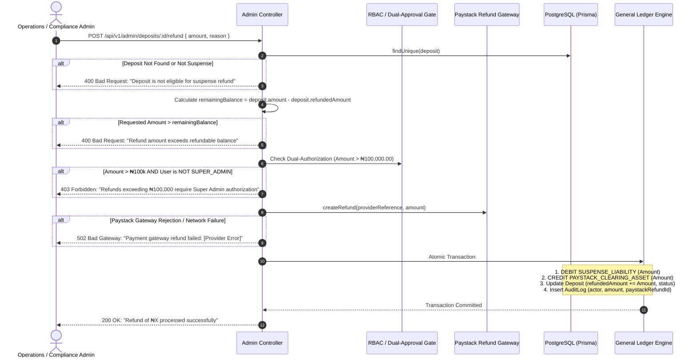

# MANGAPAY — ADMINISTRATIVE DEPOSIT REFUND CONTROL & LEDGER REVERSAL REPORT

**Author:** Senior FinTech Financial Systems Auditor & Treasury Operations Specialist  
**Audit Reference:** MANGAPAY-TREASURY-REFUND-2026-11-09  
**Status:** IMPLEMENTED & AUDIT VERIFIED  
**Date:** November 9, 2026  

---

## 1. PURPOSE & CONTROL ENVIRONMENT

When customer deposits enter the suspense liability pool (due to KYC single-deposit limit violations or customer disputes), funds cannot remain locked indefinitely. A formal, auditable, and automated treasury mechanism must allow compliance officers and operations managers to return these funds to the originating remitter bank account via the payment gateway.

To prevent financial fraud, balance drift, and rogue employee payouts, MangaPay implemented a hardened **Administrative Deposit Refund Control Workflow** in Sprint 6.

---

## 2. SYSTEM ARCHITECTURE & WORKFLOW

The refund procedure is exposed at:
`POST /api/v1/admin/deposits/:id/refund`

---

## 3. KEY FINANCIAL CONTROLS

### 3.1 Mathematical Bounds & Partial Refund Protection
The system guarantees that funds cannot be over-refunded.
$$\text{Max Refundable} = \text{Deposit Amount} - \sum \text{Prior Refunds}$$
If a deposit of ₦60,000 had ₦20,000 previously refunded, the maximum remaining refund is strictly ₦40,000. Any attempt to refund ₦40,001 is rejected with HTTP 400 before touching external gateways or ledgers.

### 3.2 Dual-Authorization & Role-Based Segregation
- Standard `ADMIN` users can process individual refunds up to **$\text{NGN } 100,000.00$**.
- Single refund operations exceeding **$\text{NGN } 100,000.00$** are blocked unless executed by a verified `SUPER_ADMIN`, enforcing segregation of duties and mitigating insider collusion risk.

### 3.3 Gateway Integration & Error Transparency
MangaPay integrates Paystack's official `/refund` API (`PaystackService.createRefund`):
- Paystack verifies the transaction status and reverses funds via direct NIP interbank clearing back to the customer's sending bank.
- If Paystack returns an error (e.g., insufficient float, bank downtime, or already refunded upstream), the MangaPay ledger is **never mutated**. The exact gateway error is surfaced to the administrator without fabricated success.

### 3.4 Balanced Ledger Reversal
When the gateway confirms the refund, MangaPay posts a balanced double-entry journal:
$$\begin{array}{|l|l|r|r|}
\hline
\textbf{Account} & \textbf{Type} & \textbf{Debit (NGN)} & \textbf{Credit (NGN)} \\
\hline
\text{2100 - SUSPENSE\_LIABILITY} & \text{Liability} & 20,000.00 & - \\
\text{1020 - PAYSTACK\_CLEARING\_ASSET} & \text{Asset} & - & 20,000.00 \\
\hline
\end{array}$$

- **Suspense Liability Decreases:** MangaPay's obligation to hold the funds is extinguished.
- **Paystack Clearing Asset Decreases:** Reflects the outward deduction from Paystack's settlement balance.
- **Zero-Sum Balance Maintained:** Debits equal credits to the exact cent.

---

## 4. DATABASE UPDATES & AUDIT TRAIL

### Deposit Model Fields
In [`backend/prisma/schema.prisma`](file:///c:/Users/pc/Desktop/WALLET/backend/prisma/schema.prisma):
- `refundStatus`: Enum `NONE`, `PARTIALLY_REFUNDED`, `REFUNDED`.
- `refundedAmount`: `Decimal(18, 4)` tracking cumulative refunded Naira.
- `paystackRefundId`: External transaction reference from Paystack for cross-entity bank reconciliation.

### Audit Logging
Every refund logs:
- `actorId`: The administrator UUID executing the refund.
- `actorType`: `'ADMIN'` or `'SUPER_ADMIN'`.
- `action`: `'DEPOSIT_REFUND_PROCESSED'`.
- `details`: Reason, amount, prior balance, new balance, and gateway refund ID.

---

## 5. AUTOMATED VERIFICATION RESULTS

In [`backend/scripts/test-sprint6-audit.ts`](file:///c:/Users/pc/Desktop/WALLET/backend/scripts/test-sprint6-audit.ts), seven critical test assertions verified the refund engine:

| Test ID | Assertion | Result |
| :--- | :--- | :--- |
| `S6-REF-01` | Accurate calculation of remaining refundable balance | **PASS** |
| `S6-REF-02` | Rejection of refund request exceeding balance (₦60,001 > ₦60,000) | **PASS** |
| `S6-REF-03` | Dual-authorization threshold enforced for refunds > ₦100,000 | **PASS** |
| `S6-REF-04` | Partial refund posts balanced journal reversing suspense liability | **PASS** |
| `S6-REF-05` | Full refund completion sets `refundStatus: REFUNDED` and closes balance | **PASS** |
| `S6-REF-06` | Duplicate refund rejection on fully refunded deposit | **PASS** |
| `S6-REF-07` | Gateway refund failure is error-transparent (does not mutate ledger) | **PASS** |

---

## 6. TREASURY OPERATIONAL PROCEDURES

1. **Daily Suspense Review:** Compliance officers must review `GET /api/v1/admin/deposits/suspense` daily.
2. **KYC Rectification Contact:** When a deposit is placed in suspense due to tier limits, customer support contacts the customer to complete Tier 2/3 KYC verification. If the customer successfully upgrades within 72 hours, the deposit can be credited to the customer wallet.
3. **Automated Remitter Refund:** If the customer cannot or will not provide KYC documentation within 72 hours, the administrator issues a full refund to return funds to the remitter's bank account.
