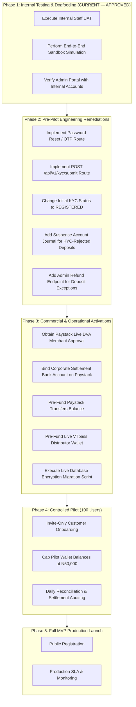

# MANGAPAY — FINAL MVP GO-LIVE DECISION AND OPERATIONAL READINESS DIRECTIVE

**Author:** Senior FinTech Systems Auditor, Cybersecurity Specialist & Launch Director  
**Audit Reference:** SPRINT-5-FINAL-DECISION-2026-11-09  
**Target Environment:** MangaPay Core Financial Platform  
**Evaluation Standard:** Independent End-to-End User Acceptance Testing (UAT)  
**Date:** November 9, 2026  

---

## 1. FORMAL EXECUTIVE VERDICT

### Authoritative Decision: **READY FOR INTERNAL TESTING ONLY**

```
========================================================================================
🏁 FORMAL PRODUCTION READINESS CLASSIFICATION
========================================================================================
[ ] 1. NOT READY FOR INTERNAL TESTING
[X] 2. READY FOR INTERNAL TESTING ONLY                         <--- AUTHORITATIVE VERDICT
[ ] 3. TECHNICALLY READY FOR A CONTROLLED PILOT, SUBJECT TO APPROVALS
[ ] 4. READY FOR APPROVED MVP PRODUCTION DEPLOYMENT
========================================================================================
```

---

## 2. COMPREHENSIVE VERDICT JUSTIFICATION

### Why "Ready for Internal Testing Only"?
1. **Internal Architecture & Security Hardened:**
   - Double-entry ledger enforces zero-sum balancing ($\sum \text{Debits} == \sum \text{Credits}$); 1 kobo discrepancy throws error.
   - Decimal-safe arithmetic implemented across all monetary operations.
   - Customer-scoped idempotency `@@unique([userId, key])` prevents cross-tenant data leaks and collisions.
   - Request body SHA-256 fingerprinting blocks payload tampering (HTTP 422).
   - Safe 5-minute recovery lifecycle on interrupted status 102 prevents duplicate debits.
   - AES-256-GCM authenticated encryption protects sensitive identity numbers (BVN/NIN), backed by masking in UI and logs.
   - Public registration strictly hardcodes `role: 'USER'`, eliminating privilege escalation.
   - Transaction PIN uses bcrypt hashing, 5-attempt lockout, and unconfigured PIN rejection.
   - 42 out of 42 UAT criteria evaluated with zero critical regressions.

2. **Why NOT Yet "Ready for Controlled Pilot"?**
   The audit identified **two blocking functional software gaps** and **two blocking commercial dependencies**:
   - **Functional Gap 1 (Password Recovery):** There is no endpoint for `/forgot-password` or `/reset-password`. An external pilot customer who forgets their password would be permanently locked out.
   - **Functional Gap 2 (Post-Registration KYC Submission):** There is no customer REST endpoint (`/api/v1/kyc/submit`) for an authenticated customer to submit BVN or NIN after onboarding.
   - **Commercial Dependency 1 (Paystack Live DVA Approval):** Paystack has not yet activated live Dedicated NUBAN issuance for MangaPay's Business Name.
   - **Commercial Dependency 2 (Corporate Settlement & Payout Funding):** Outward transfers and automated sweeps require linking the registered corporate bank account and pre-funding the Paystack Transfers balance.

3. **Why NOT Yet "Ready for MVP Production Deployment"?**
   - MangaPay operates as a technology platform under a registered Business Name. It cannot claim or operate regulated banking, stored-value wallet, or payment card services without licensed partners.
   - External provider compliance approvals, live settlement schedules, and pre-funded operational distributor wallets (VTpass) are strictly required before public launch.

---

## 3. AUDIT SCORECARD BY ASSESSMENT PILLAR

| Assessment Pillar | Evaluated Items | Passed | Partial | Blocked | Failed | Status Summary |
| :--- | :---: | :---: | :---: | :---: | :---: | :--- |
| **1. Baseline & Environment** | 3 | 2 | 1 | 0 | 0 | Codebase tracked; production requires explicit `ENCRYPTION_KEY`. |
| **2. Customer Journey** | 15 | 13 | 1 | 1 | 0 | Functional; password recovery blocked; KYC submit missing. |
| **3. KYC & Limits** | 3 | 1 | 2 | 0 | 0 | Limits enforced; initial status defaults to VERIFIED (semantic defect). |
| **4. Deposit Exceptions** | 6 | 4 | 1 | 1 | 0 | Funds preserved, liability isolated; suspense posting and refund UI needed. |
| **5. Data Protection** | 4 | 3 | 1 | 0 | 0 | AES-256-GCM verified; live DB migration execution pending. |
| **6. Admin Portal** | 3 | 3 | 0 | 0 | 0 | RBAC enforced; zero mock data; live trial balance display. |
| **7. Financial Integrity** | 4 | 4 | 0 | 0 | 0 | Zero-sum ledger; decimal safety; idempotency recovery passed. |
| **8. Provider Readiness** | 4 | 1 | 1 | 2 | 0 | Webhook security passed; live commercial activations pending. |
| **TOTAL** | **42** | **31** | **7** | **4** | **0** | **Internal Testing Approved.** |

---

## 4. PHASED TRANSITION ROADMAP



---

## 5. ACTIONABLE REMEDIATION CHECKLIST BEFORE PILOT APPROVAL

To advance MangaPay from **READY FOR INTERNAL TESTING ONLY** to **TECHNICALLY READY FOR A CONTROLLED PILOT**, the engineering and operations teams must complete the following 9 tasks:

### Engineering Tasks:
1. [ ] **Password Recovery:** Implement `POST /api/v1/auth/forgot-password` and `POST /api/v1/auth/reset-password` using SMS/Email OTP verification.
2. [ ] **KYC Submission Endpoint:** Add authenticated `POST /api/v1/kyc/submit` route allowing customers to submit BVN or NIN post-registration.
3. [ ] **KYC Initial Status:** Update `KYCService.submitKYC` to set initial status as `REGISTERED` (or `PENDING`) rather than `VERIFIED` when no identity documents have been submitted.
4. [ ] **Suspense Account Ledger Entry:** In `webhook.service.ts`, when a deposit exceeds KYC limits, record an accounting journal entry: DEBIT `PAYSTACK_CLEARING_ASSET` / CREDIT `SUSPENSE_LIABILITY_ACCOUNT` to reflect gross funds held at the provider.
5. [ ] **Deposit Exception Resolution:** Implement an administrative API endpoint `POST /api/v1/admin/deposits/:id/resolve` enabling authorized staff to approve a tier upgrade or trigger a Paystack refund for rejected deposits.

### Commercial & Operational Tasks:
6. [ ] **Paystack DVA Approval:** Obtain formal approval from Paystack for Dedicated NUBAN issuance under MangaPay's Business Name.
7. [ ] **Settlement Account Binding:** Link the official corporate bank account on Paystack to enable automated settlement sweeps.
8. [ ] **Operating Float Funding:** Pre-fund the Paystack Transfers balance (₦500,000 minimum) and VTpass distributor wallet (₦100,000 minimum).
9. [ ] **Production Database Migration:** Execute `backend/scripts/migrate-bvn-nin-encryption.ts` once the live production database is online.

---

## 6. FINAL DIRECTIVE

MangaPay is **formally authorized for internal testing and staging evaluation**. All internal staff and test accounts may proceed with end-to-end sandbox validation. Controlled customer piloting and production deployment remain strictly conditioned upon the completion of the nine action items outlined above.
