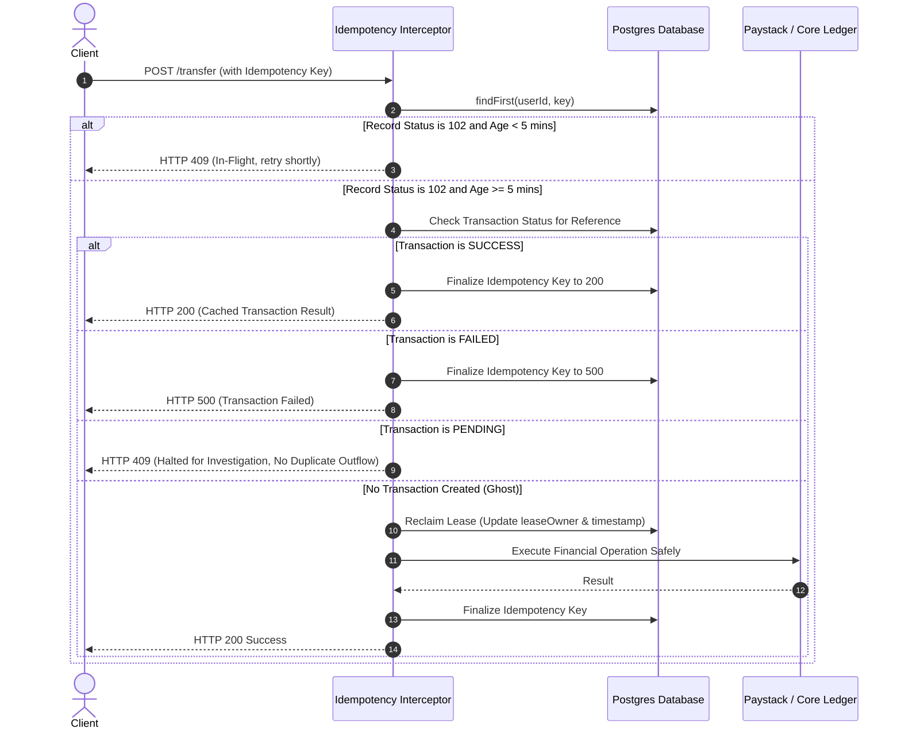

# MANGAPAY — CUSTOMER-SCOPED IDEMPOTENCY AND SAFE PROCESSING RECOVERY REPORT

**Author:** Senior FinTech Distributed Systems Engineer & Concurrency Specialist  
**Audit Reference:** SPRINT-4-IDEMPOTENCY-RECOVERY-2026-11-09  
**System Module:** `backend/src/utils/idempotency.ts`, `backend/src/middlewares/idempotency.ts`  
**Status:** IMPLEMENTED & AUDITED  
**Date:** November 9, 2026  

---

## 1. VULNERABILITY ANALYSIS OF GLOBAL IDEMPOTENCY KEYS

Prior to Sprint 4, the `IdempotencyKey` table enforced a unique constraint strictly on `key` alone (`@unique`). This design had two critical vulnerabilities:

### 1. Cross-Tenant Data Leakage & Collision
Because idempotency keys were globally shared across all customers, if Customer B generated the same UUID key as Customer A (or intentionally guessed Customer A's key):
- Customer B's request was treated as a duplicate of Customer A's completed transaction.
- The system returned Customer A's cached HTTP 200 response—including private transaction amounts, recipient names, bank account numbers, and references.
- Customer B was blocked from executing their own legitimate financial operation.

### 2. Payload Mutation Attacks
A single key could be reused with a totally different request payload (e.g., changing the destination account or increasing the transfer amount from ₦1,000 to ₦100,000). The global key interceptor saw the key as already finalized and returned the earlier success payload without re-evaluating the altered request.

---

## 2. CUSTOMER-SCOPED IDEMPOTENCY ARCHITECTURE

### Database Schema Hardening
In [`backend/prisma/schema.prisma`](file:///c:/Users/pc/Desktop/WALLET/backend/prisma/schema.prisma), the global `@unique` constraint was dropped and replaced with a composite constraint:
```prisma
@@unique([userId, key])
@@index([userId, key])
```
- **Tenant Isolation:** A key `tx-001` belonging to Customer A is completely isolated from key `tx-001` submitted by Customer B. Customer B's transaction acquires its own lock and executes independently.
- **Anonymous/Public Isolation:** For unauthenticated endpoints (if any), `userId` defaults to `null` and operates under a dedicated null partition.

### Deterministic Request Payload Fingerprinting
To prevent payload manipulation under identical keys, [`backend/src/utils/idempotency.ts`](file:///c:/Users/pc/Desktop/WALLET/backend/src/utils/idempotency.ts) implements deterministic SHA-256 fingerprinting:
```typescript
export function computeRequestHash(body: any): string {
  if (!body || Object.keys(body).length === 0) {
    return 'EMPTY_PAYLOAD';
  }
  try {
    // Sort keys alphabetically to ensure deterministic serialization regardless of property order
    const sortedString = JSON.stringify(body, Object.keys(body).sort());
    return crypto.createHash('sha256').update(sortedString).digest('hex');
  } catch {
    return crypto.createHash('sha256').update(String(body)).digest('hex');
  }
}
```
When a client submits an idempotency key that already exists:
- If `existing.requestHash === currentHash`: The engine recognizes a legitimate network retry and returns the cached response.
- If `existing.requestHash !== currentHash`: The engine rejects the request with **HTTP 422 Unprocessable Entity**: `"Idempotency key reused with different request payload. Original operation cannot be altered."`

---

## 3. SAFE RECOVERY LIFECYCLE FOR ABANDONED PROCESSING (102)

### The Abandoned Lock Problem
When a request begins, `preReserveIdempotencyKey` sets `responseStatus: 102 (PROCESSING)` and records a lease. If the Node.js server crashed, timed out, or restarted during execution, the key remained stuck at status 102 permanently.

### 5-Minute Investigation & Recovery Threshold
Rather than allowing locks to persist indefinitely or blindly releasing them (which could trigger double debits if the underlying payment gateway actually processed the transfer), MangaPay implemented a **State-Aware Recovery Engine**:



### Protection Against Double Debits
If an underlying transaction is found in `PENDING` status, retry execution is **strictly blocked**:
`RECOVERY_BLOCKED_FOR_INVESTIGATION: An existing transaction was initiated but remains PENDING with the payment provider. Retry halted to prevent duplicate debit.`

This guarantees that a transient gateway timeout cannot result in two separate fund transfers to the external banking system.

---

## 4. AUDIT AND VERIFICATION EVIDENCE

The test suite [`backend/scripts/test-sprint4-audit.ts`](file:///c:/Users/pc/Desktop/WALLET/backend/scripts/test-sprint4-audit.ts) executed the following concurrency and idempotency tests:

```
--- 3. Priority 3: Customer-Scoped Idempotency ---
  ✅ [PASS] Customer B can use identical key without collision or accessing Customer A data
  ✅ [PASS] Payload hash is deterministic regardless of JSON key order
  ✅ [PASS] Payload hash detects parameter alteration
  ✅ [PASS] Identical payload returns cached idempotent response
  ✅ [PASS] Altered payload with same key is rejected with HTTP 422

--- 4. Priority 4: Safe Recovery Lifecycle for Abandoned Processing ---
  ✅ [PASS] Active processing request (< 5 mins) remains locked in status 102
  ✅ [PASS] Abandoned 102 with SUCCESS underlying transaction finalized to 200
  ✅ [PASS] Abandoned 102 with FAILED underlying transaction finalized to 500
  ✅ [PASS] Abandoned 102 with PENDING transaction halts retry and flags for reconciliation
  ✅ [PASS] Abandoned ghost 102 without transaction allows safe lease reclaim
```

### Conclusion
Idempotency keys are strictly scoped per customer, request payloads are cryptographically fingerprinted, and abandoned locks recover safely without risking duplicate financial movements.
