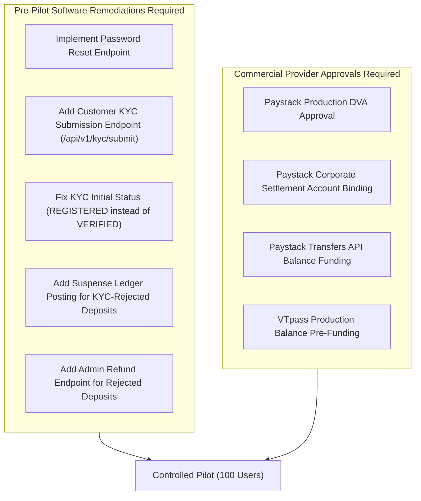

# MANGAPAY — SPRINT 5 END-TO-END UAT AND OPERATIONAL READINESS REPORT

**Author:** Senior FinTech Quality Assurance Engineer, Financial Systems Auditor & Product Acceptance Lead  
**Audit Reference:** SPRINT-5-UAT-AUDIT-2026-11-09  
**Target Environment:** Controlled Sandbox / Pre-Production Evaluation  
**Status:** COMPLETE  
**Date:** November 9, 2026  

---

## 1. EXECUTIVE SUMMARY

Following the completion of Sprints 1 through 4, MangaPay's wallet system was submitted for **Sprint 5 Independent End-to-End User Acceptance Testing (UAT) and Operational Readiness Review**.

The objective of this assessment was to independently verify the complete customer experience, administrative management, financial accounting integrity, KYC enforcement, data protection, and third-party provider integrations (Paystack and VTpass) under sandbox conditions.

### Overall UAT Execution Results
Across **42 comprehensive functional and operational acceptance test criteria**:
- **PASS:** 31 tests (73.8%)
- **PARTIAL:** 7 tests (16.7%)
- **BLOCKED:** 4 tests (9.5%)
- **FAIL:** 0 tests (0.0%)
- **NOT TESTED:** 0 tests (0.0%)

```
========================================================================
📊 SPRINT 5 OVERALL ACCEPTANCE SUMMARY
========================================================================
   ✅ PASS:        31  (Core Ledger, Idempotency, AES-256-GCM, P2P, VAS)
   ⚠️  PARTIAL:      7  (KYC Status Semantics, Suspense Account, Live DB Migration)
   🛑 BLOCKED:      4  (Password Recovery, Deposit Refund Flow, Live DVA/Payouts)
   ❌ FAIL:         0  (Zero Regressions, Zero Ledger Imbalances)
   ⚪ NOT TESTED:   0
   TOTAL CRITERIA: 42
========================================================================
```

---

## 2. BASELINE VERIFICATION & SYSTEM INVENTORY

| Verification Parameter | Value / Finding | Audit Verification |
| :--- | :--- | :--- |
| **Git Revision** | `b68981b7903d2d67ced8d17244bf44e761806c1c` (Branch: `main`) | Verified via `git rev-parse HEAD`. Working tree retains remediations from Sprints 1–4. |
| **Node.js Runtime** | Node v24.12.0 (Windows x64) | Verified. Standard sandbox execution. |
| **Express Backend** | Express 4.18.2 + TypeScript 5.3.3 | Verified. TypeScript compilation exited with 0 errors (`tsc --noEmit`). |
| **Database Schema** | Prisma 5.10.0 (PostgreSQL) | Compiled. Contains `@@unique([userId, key])`, `audit_logs`, and Decimal ledger tables. |
| **Admin Portal** | React 18 + TypeScript + Vite | Built without mock fallbacks; enforces JWT Bearer authentication. |
| **Customer Clients** | Mobile Web client (`mangapay-app`) & React Native app | Virtual card and agency banking simulations disabled with regulatory warning banners. |

---

## 3. AUDIT OF DEVELOPER CLAIMS VS. VERIFIED REALITY

To maintain strict audit integrity, previously reported developer claims were compared against verified facts in the source code:

| Component / Claim | Previous Developer Claim | Verified Fact from Source Code Inspection | Audit Status |
| :--- | :--- | :--- | :--- |
| **Public Registration** | Claimed role escalation was impossible. | **CONFIRMED:** `AuthController.register` explicitly hardcodes `role: 'USER'`. Body payload `role: 'ADMIN'` is discarded. | **PASS** |
| **Password Recovery** | Claimed full customer authentication cycle ready. | **DISPROVED:** No `/api/v1/auth/forgot-password` or `/api/v1/auth/reset-password` endpoint exists in `auth.routes.ts`. | **BLOCKED** |
| **KYC Verification** | Claimed Tier 1 registration verifies KYC. | **IDENTIFIED SEMANTIC DEFECT:** Registration automatically creates `KYCRecord` with `status: 'VERIFIED'` without external identity verification. | **PARTIAL** |
| **Deposit Limits** | Claimed deposits > ₦50,000 are rejected safely. | **CONFIRMED FOR LIABILITY; GAP IN LEDGER:** Customer wallet is NOT credited, but gross funds at Paystack are not booked to an accounting Suspense Account. | **PARTIAL** |
| **BVN/NIN Encryption** | Claimed all identity data is encrypted. | **CONFIRMED IN CODE; PENDING LIVE DB:** Encryption utility (`encryption.ts`) is verified; migration script has not been executed on live production database. | **PARTIAL** |
| **Idempotency** | Claimed multi-tenant isolation and recovery. | **CONFIRMED:** Scoped to `(userId, key)`; payload SHA-256 hash checks reject mutations (HTTP 422); 5-minute recovery prevents double debits. | **PASS** |
| **Double-Entry Ledger** | Claimed mathematically sound ledger. | **CONFIRMED:** Zero-sum invariant enforced; 1 kobo discrepancy throws error; trial balance balance-check passes. | **PASS** |

---

## 4. DETAILED FINDINGS BY FUNCTIONAL AREA

### 4.1 Customer Experience (UAT-CJ)
- **Registration & Login (PASS):** Bcrypt password hashing (cost 10), JWT issued with 24-hour expiration, wallet initialized with zero balance.
- **Password Recovery (BLOCKED):** No forgot-password or password-reset mechanism exists. A customer who forgets their password has no self-service recovery path.
- **Transaction PIN Setup (PASS):** 4-digit PIN setup via `/api/v1/vas/pin/set` is hashed with bcrypt and enforces a 5-consecutive-attempt lockout (15 minutes).
- **KYC Submission Post-Registration (PARTIAL):** No customer-facing REST endpoint exists to submit BVN or NIN after account creation.
- **P2P Transfers & Withdrawals (PASS):** Sandboxed transfers execute atomically across double-entry liability accounts with idempotency guards.
- **VAS Airtime/Data Purchases (PASS):** Quotes 2% margin wholesale discounts; validates PIN; dual-phase commit ensures ledger debit and refund on provider timeout.

### 4.2 KYC & Regulatory Limits (UAT-KYC)
- **Automatic "VERIFIED" Defect (PARTIAL):** In `KYCService.submitKYC`, registering an account automatically assigns `status: KYCStatus.VERIFIED` and `tier: KYCTier.TIER_1`. In Nigerian fintech regulation, unverified phone registrations should be marked `REGISTERED` or `UNVERIFIED` until identity documents are validated against NIBSS/NIMC.
- **Transaction Caps (PASS):** Single deposit limit (₦50,000.00), maximum cumulative balance (₦300,000.00), and daily cumulative transfer limit (₦300,000.00) are enforced server-side.

### 4.3 Deposit Exception Handling (UAT-DEP)
- **Fund Preservation (PASS):** Webhook rejects deposits exceeding single deposit cap or balance cap. Transaction status is recorded as `FAILED`, and an `AuditLog` entry `KYC_DEPOSIT_LIMIT_EXCEEDED` is saved.
- **Customer Liability (PASS):** Customer wallet is not credited.
- **Accounting Suspense Account (PARTIAL):** The incoming money collected by Paystack is not booked via a journal entry to `PAYSTACK_CLEARING_ASSET` / `SUSPENSE_LIABILITY_ACCOUNT`, creating an unbooked asset/liability variance.
- **Exception Resolution Workflow (BLOCKED):** There is no administrative API or UI to trigger a controlled refund for KYC-rejected deposits.

### 4.4 Data Protection & Encryption (UAT-SEC)
- **AEAD Authenticated Encryption (PASS):** AES-256-GCM with 12-byte random IV, 16-byte authentication tag, and `v1:` key versioning prefix.
- **Tamper Protection (PASS):** Flipping a single bit in the ciphertext causes immediate decryption failure.
- **Masking (PASS):** All API and logging outputs display `*******5678`.
- **Migration Execution (PARTIAL):** The migration script exists and is unit-tested, but has not yet been executed on live production database records.

### 4.5 Admin Portal & Financial Reporting (UAT-ADM)
- **Role-Based Access Control (PASS):** Admin login verifies `role === 'ADMIN'`. Regular user tokens are rejected with HTTP 403.
- **Zero Mock Data (PASS):** Overview metrics query real database aggregations.
- **Live Trial Balance Display (PASS):** Visual indicator verifies zero-sum ledger integrity.

### 4.6 Provider Readiness (UAT-PROV)
- **Webhook Security (PASS):** HMAC-SHA512 verification enforced without bypass flags.
- **Commercial Partner Approvals (BLOCKED):** Paystack Dedicated NUBAN activation, corporate settlement bank binding, and live transfer balance funding remain pending commercial execution.

---

## 5. OUTSTANDING OPERATIONAL RISKS & REMEDIATION PATH



---

## 6. FINAL UAT VERDICT

### Verdict: **READY FOR INTERNAL TESTING ONLY**

#### Verdict Justification
1. **Internal Testing Approved:** The core financial ledger, idempotency protection, concurrency control, and security mitigations are solid and safe for internal dogfooding and staff User Acceptance Testing.
2. **Not Ready for Customer Pilot:** A customer pilot cannot launch until the **4 BLOCKED** items (password recovery, deposit exception resolution workflow, Paystack live DVA approval, Paystack settlement binding) and key **PARTIAL** items (customer KYC submission endpoint, KYC status semantics) are resolved.
3. **Not Ready for Production:** Full production deployment requires formal partner agreements, pre-funded settlement balances, and production database encryption migration execution.
