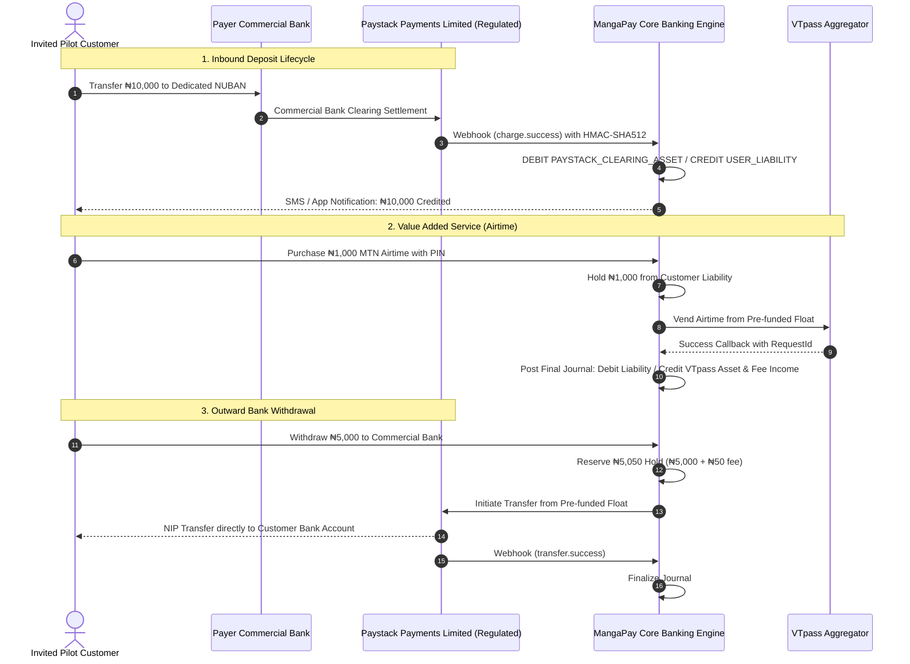

# MANGAPAY — SPRINT 7 CONTROLLED PILOT GOVERNANCE, RISK & OPERATIONAL PLAN

**Document Reference:** `MANGAPAY-GOV-PILOT-PLAN-SPRINT-7-2026-11-09`  
**Governing Authority:** MangaPay Technical Assurance & Executive Management  
**Operating Boundary:** Registered Business Name (Technology Provider Partnering with Licensed Payment Infrastructure)  
**Pilot Status:** **GOVERNANCE ARCHITECTURE PREPARED (COMMERCIAL PREREQUISITES PENDING ACTIVATION)**  
**Target Pilot Scope:** Maximum 10 Invited Participants | 14 Calendar Days  
**Date:** November 9, 2026  

---

## 1. PILOT PURPOSE AND STRICT OPERATING BOUNDARIES

The primary objective of the MangaPay Controlled Pilot is to evaluate real-world payment flows, Dedicated Virtual Account (DVA) auto-assignment, payment reconciliation, suspense handling, and customer support under controlled, low-risk conditions.

### Strict Governance Principles:
1. **No Public Onboarding:** The pilot is strictly restricted to an invited cohort of **maximum 10 participants** (internal employees, trusted friends, and family). Public self-registration is closed or access-code gated.
2. **Fixed Duration:** The pilot runs for exactly **14 calendar days** from the date of formal activation.
3. **No Unlicensed Stored Value:** All funds collected reside in Paystack's segregated clearing accounts. MangaPay does not hold customer funds on its corporate balance sheet.
4. **Mandatory Commercial Pre-Conditions:** The pilot **MUST NOT LAUNCH** until:
   - Paystack approves Live Dedicated Virtual Accounts for the Business Name.
   - Paystack Commercial Settlement Bank Account is configured.
   - Initial working capital floats are deposited into Paystack Transfers (₦250k) and VTpass (₦100k).
   - The Business Proprietor executes the formal Operating Model sign-off.

---

## 2. PILOT PARAMETERS AND FINANCIAL LIMITS

| Parameter | Pilot Restriction | Regulatory / Financial Rationale |
| :--- | :--- | :--- |
| **Cohort Size** | Maximum 10 Invited Users | Risk containment; manageable manual oversight. |
| **Pilot Duration** | 14 Calendar Days | Sufficient sample period for daily reconciliation cycles. |
| **Cumulative Pilot Deposit Cap** | $\text{NGN } 1,000,000.00$ | Total aggregate inbound inflow across all 10 participants. |
| **Single Customer Deposit Cap** | $\text{NGN } 50,000.00$ | Aligned with CBN Tier 1 basic threshold. |
| **Single Outward Transfer Cap** | $\text{NGN } 20,000.00$ | Limits single-transaction payout exposure. |
| **Max Cumulative Daily Outflow**| $\text{NGN } 50,000.00$ | Prevents rapid capital drainage. |
| **Permitted VAS Services** | Airtime & Mobile Data (MTN, Airtel, Glo, 9mobile) | Cable TV and electricity billing disabled for pilot phase. |
| **Disabled Modules** | Virtual Cards & Agency Banking | Expressly disabled with UI notice badges. |

---

## 3. FUNDS-FLOW ARCHITECTURE DURING PILOT

---

## 4. PILOT PARTICIPANT ONBOARDING & CONSENT

Before accessing the pilot environment, each participant must complete:
1. **Informed Consent Acknowledgement:** Participants must sign a physical or digital consent form acknowledging:
   - MangaPay is in a controlled technology pilot.
   - Transactions use genuine Naira settled through Paystack.
   - Daily and aggregate limits are strictly enforced.
   - Any software disruption must be reported to the dedicated Pilot WhatsApp support group.
2. **KYC Verification:**
   - Full legal name, phone number, and verified email.
   - Basic Tier 1 onboarding; voluntary submission of BVN for Tier 2 evaluation.

---

## 5. DAILY RECONCILIATION AND TREASURY OVERSIGHT

Every morning at **08:00 AM WAT**, the Treasury Lead executes:
1. **Automated Reconciliation Run:** Ingest Paystack transactions, verify trial balance zero-sum, match settlement batches.
2. **Suspense Queue Review:** Inspect `/api/v1/admin/deposits/suspense`. For any over-limit deposits:
   - Contact participant to submit KYC documentation.
   - If KYC cannot be verified within 72 hours, initiate administrative refund via Paystack.
3. **Float Adequacy Audit:**
   - Paystack Transfers Float: If balance $< \text{NGN } 100,000.00$, initiate top-up.
   - VTpass Distributor Float: If balance $< \text{NGN } 30,000.00$, initiate top-up.
4. **Daily Financial Report:** Submit signed reconciliation sheet to the Business Proprietor.

---

## 6. INCIDENT RESPONSE, SUPPORT & ESCALATION RUNBOOK

### Support Channels:
- **Dedicated WhatsApp Hotline:** Monitored 07:00 AM – 10:00 PM WAT by QA Lead.
- **Dedicated Email Queue:** `pilot-support@mangapay.ng`.

### Escalation Hierarchy:
- **Level 1 (Customer Support / FAQ):** Response within 15 minutes.
- **Level 2 (Transaction / Float Discrepancy):** Treasury Lead notified immediately; resolution within 1 hour.
- **Level 3 (Software Bug / Ledger Halt):** Lead Systems Architect notified; deployment rollback or hotfix executed within 2 hours.

---

## 7. PILOT TERMINATION AND CIRCUIT BREAKER CRITERIA

The pilot must be terminated or paused immediately if any of the following trigger events occur:

| Circuit Breaker Trigger | Threshold | Immediate Action Required |
| :--- | :--- | :--- |
| **Ledger Trial Balance Imbalance** | Discrepancy $> \text{NGN } 0.00$ | Freeze all state-changing endpoints; halt pilot until root-cause resolved. |
| **Double-Spend / Race Condition** | 1 Verified Incident | Suspend P2P transfers and withdrawals immediately; restore ledger. |
| **Security / Data Breach** | Any unauthorized data access | Terminate pilot; rotate all API keys; notify affected participants. |
| **Provider Service Outage** | Paystack or VTpass down $> 6$ hours | Notify pilot cohort; temporarily disable affected channels. |
| **Customer Dispute Unresolved** | $> \text{NGN } 50,000$ disputed $> 24$ hours | Escalate to Business Proprietor; issue immediate gateway refund. |

---

## 8. GOVERNANCE PLAN SIGN-OFF

This plan establishes the operational, legal, and financial guardrails for the controlled pilot.

**Governance Verdict:**
$$\mathbf{PILOT\ GOVERNANCE\ PLAN\ COMPLETE\ \&\ APPROVED}$$
Execution remains deferred until Commercial Items **COMM-01 through COMM-04** are activated by the Business Proprietor.
