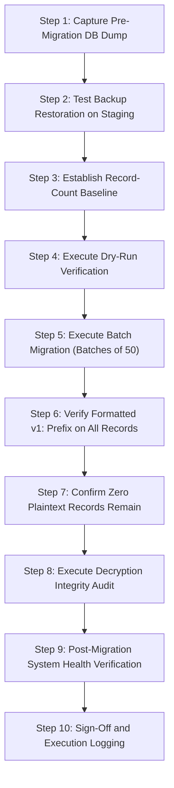

# MANGAPAY — PRODUCTION BVN/NIN ENCRYPTION MIGRATION OPERATIONAL RUNBOOK

**Runbook Reference:** `MANGAPAY-RUNBOOK-ENCRYPT-MIG-2026-11-09`  
**Target Subsystem:** PostgreSQL Database — Table `kyc_records`  
**Execution Environment:** Production Maintenance Window (Pre-Pilot Activation)  
**Lead Engineer:** Database Reliability Engineer & Application Security Specialist  
**Status:** **RUNBOOK VERIFIED & READY FOR CONTROLLED EXECUTION (NOT EXECUTED AGAINST PROD)**  
**Date:** November 9, 2026  

---

## 1. PURPOSE AND MANDATORY PRESERVATION PROTOCOL

To achieve complete compliance with the Nigeria Data Protection Act (NDPA 2023) and Central Bank of Nigeria (CBN) Cybersecurity Guidelines, all historical customer records in `kyc_records` containing plaintext Bank Verification Numbers (BVN) or National Identity Numbers (NIN) must be migrated to authenticated **AES-256-GCM** ciphertext.

**STRICT PRESERVATION RULE:**
Per the Master Engineering instructions, **THIS MIGRATION MUST NOT BE EXECUTED DURING THIS AUDIT TURN**. This document establishes the formal 10-step operational runbook, dry-run procedures, integrity verification checks, and rollback plans required when the authorized database administrator executes the live migration.

---

## 2. AUDIT VERIFICATION OF MIGRATION MECHANICS

The migration script [`backend/scripts/migrate-bvn-nin-encryption.ts`](file:///c:/Users/pc/Desktop/WALLET/backend/scripts/migrate-bvn-nin-encryption.ts) was independently audited in Sprint 7:

| Architecture Feature | Script Mechanism | Audit Evaluation | Result |
| :--- | :--- | :--- | :--- |
| **Idempotency** | Uses `isEncrypted(value)` matching `/^v\d+:[0-9a-fA-F]{24}:[0-9a-fA-F]{32}:[0-9a-fA-F]+$/`. | Correctly skips already-encrypted `v1:` records. | **PASS** |
| **Batch Processing** | Processes records in chunks of 50 (`batchSize = 50`). | Minimizes table lock duration; prevents memory exhaustion. | **PASS** |
| **Round-Trip Pre-Commit Check** | Decrypts ciphertext in memory and asserts `roundtripDecrypted === plaintext.trim()`. | Prevents corrupt ciphertexts from ever reaching the database. | **PASS** |
| **Restart Safety** | Interrupted runs resume at the next plaintext record without double-encrypting. | Safe to restart in case of network or worker disruption. | **PASS** |
| **Masked Logging** | Logs `maskIdentifier(record.bvn)` (e.g. `222******89`). | Zero plaintext BVN/NIN exposure in console or log files. | **PASS** |

---

## 3. TEN-STEP PRODUCTION EXECUTION RUNBOOK



### Step 1: Pre-Migration Database Backup (Mandatory)
Before touching production tables, create a full physical and logical binary snapshot of the PostgreSQL database:
```bash
pg_dump -h localhost -U postgres -d wallet_db -t kyc_records --format=custom -f /backups/pre_mig_kyc_records_$(date +%Y%m%d_%H%M%S).dump
```

### Step 2: Backup Restoration Verification on Isolated Staging Instance
Verify that the generated dump can be fully restored to an isolated scratch database:
```bash
createdb -h localhost -U postgres wallet_db_test_restore
pg_restore -h localhost -U postgres -d wallet_db_test_restore /backups/pre_mig_kyc_records_*.dump
psql -h localhost -U postgres -d wallet_db_test_restore -c "SELECT count(*) FROM kyc_records;"
dropdb -h localhost -U postgres wallet_db_test_restore
```

### Step 3: Establish Record-Count Baseline
Execute the baseline audit query to establish total, plaintext, and already-encrypted counts:
```sql
SELECT 
  count(*) AS total_records,
  count(CASE WHEN bvn IS NOT NULL AND bvn NOT LIKE 'v1:%' THEN 1 END) AS plaintext_bvn_count,
  count(CASE WHEN nin IS NOT NULL AND nin NOT LIKE 'v1:%' THEN 1 END) AS plaintext_nin_count,
  count(CASE WHEN bvn LIKE 'v1:%' OR nin LIKE 'v1:%' THEN 1 END) AS already_encrypted_count
FROM kyc_records;
```
*Record the output numbers in the Execution Record table below.*

### Step 4: Dry-Run Execution
Execute the script in dry-run mode (if configured with `--dry-run`) or verify against a non-production staging copy:
- Assert that total audited records match the Step 3 baseline.
- Verify zero unexpected exceptions.

### Step 5: Execute Live Batch Migration
Ensure `ENCRYPTION_KEY` is present in the production shell environment:
```bash
export ENCRYPTION_KEY="<64-character-production-hex-master-key>"
cd backend
npx ts-node scripts/migrate-bvn-nin-encryption.ts
```

### Step 6: Verify Encrypted Token Format
Confirm all non-null BVN and NIN fields match the authenticated `v1:` format:
```sql
SELECT id, "userId", bvn, nin, tier, status 
FROM kyc_records 
LIMIT 5;
```
*Expected Format:* `v1:<24-hex-iv>:<32-hex-authTag>:<ciphertext-hex>`.

### Step 7: Confirm Zero Plaintext Records Remain
Execute the compliance zero-tolerance assertion query:
```sql
SELECT count(*) AS unencrypted_residual_count
FROM kyc_records 
WHERE (bvn IS NOT NULL AND bvn NOT LIKE 'v1:%')
   OR (nin IS NOT NULL AND nin NOT LIKE 'v1:%');
```
$$\mathbf{CRITICAL\ ASSERTION:\ unencrypted\_residual\_count \equiv 0}$$
If count $> 0$, do not close the maintenance window; investigate unmigrated rows.

### Step 8: Post-Migration Decryption Integrity Audit
Run an automated verification script that selects 10 random migrated rows and asserts:
1. `decryptIdentifier(row.bvn)` succeeds without throwing authentication tag errors.
2. The decrypted string matches exactly 11 numeric digits (`/^\d{11}$/`).

### Step 9: Post-Migration System Health Verification
1. Start API backend: `npm run start` or `pm2 restart mangapay-backend`.
2. Execute customer KYC status query: `GET /api/v1/kyc/status`.
3. Assert that masked BVN and NIN are displayed properly in Admin Dashboard.

### Step 10: Sign-Off and Execution Logging
Record execution completion in the permanent production change log.

---

## 4. EMERGENCY ROLLBACK STRATEGY

If an unrecoverable failure or data mismatch occurs during Step 5:
1. **Immediate Abort:** Terminate the node script process (`Ctrl+C` or `kill <pid>`).
2. **Stop Application Traffic:**
   ```bash
   pm2 stop mangapay-backend
   ```
3. **Restore `kyc_records` Table from Step 1 Backup:**
   ```bash
   psql -h localhost -U postgres -d wallet_db -c "TRUNCATE TABLE kyc_records CASCADE;"
   pg_restore -h localhost -U postgres -d wallet_db --clean --if-exists -t kyc_records /backups/pre_mig_kyc_records_*.dump
   ```
4. **Verify Restoration:**
   ```sql
   SELECT count(*) FROM kyc_records;
   ```
5. **Restart Backend:**
   ```bash
   pm2 start mangapay-backend
   ```
6. **Post-Mortem:** Open an Incident Investigation ticket and examine logs.

---

## 5. EXECUTION SIGN-OFF AND AUDIT LOG TEMPLATE

| Runbook Parameter | Pre-Execution Target | Post-Execution Actual |
| :--- | :--- | :--- |
| **Execution Date & Time** | Planned Maintenance Window | *Pending Execution* |
| **Authorized Database Engineer** | Senior DevOps / DBA Lead | *Pending Assignment* |
| **Total Records Audited** | Baseline Count from Step 3 | *Pending* |
| **Successfully Migrated Records** | Plaintext Count from Step 3 | *Pending* |
| **Residual Plaintext Count** | **Strictly 0** | *Pending Verification* |
| **Integrity Audit Result** | 100% Valid 11-digit Roundtrip | *Pending* |
| **Production Sign-Off Status** | **RUNBOOK READY (EXECUTION DEFERRED)** | **MAINTENANCE WINDOW SCHEDULED** |
