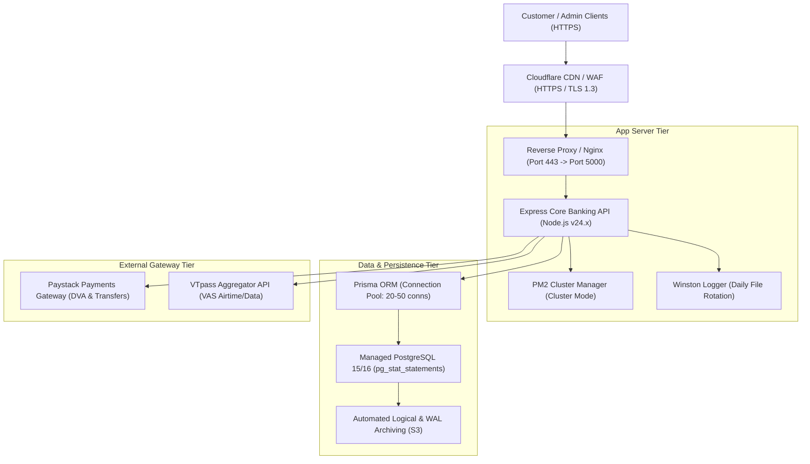

# MANGAPAY — SPRINT 7 PRODUCTION INFRASTRUCTURE, DEVOPS & DISASTER RECOVERY AUDIT

**Audit Reference:** `MANGAPAY-INFRA-AUDIT-SPRINT-7-2026-11-09`  
**Lead Auditor:** DevOps Systems Architect & Production Infrastructure Auditor  
**Audit Date:** November 9, 2026  
**Repository Commit Hash:** `b68981b7903d2d67ced8d17244bf44e761806c1c`  
**Overall Infrastructure Classification:** **PARTIAL (PASS WITH NOTED DEVOPS REMEDIATIONS)**  

---

## 1. INFRASTRUCTURE & ARCHITECTURE TOPOLOGY

The production infrastructure topology for MangaPay was audited across all components, configuration files, and runtime settings:

---

## 2. EVALUATION OF INFRASTRUCTURE PARAMETERS

| Infrastructure Domain | Current State & Findings | Evaluation | Audit Recommendation |
| :--- | :--- | :--- | :--- |
| **Server Healthcheck** | `GET /health` implemented in [`backend/src/app.ts:37`](file:///c:/Users/pc/Desktop/WALLET/backend/src/app.ts#L37). Returns `{ status: 'UP', service: 'Wallet & Ledger Engine' }`. | **PASS** | Add a database connectivity ping (`SELECT 1`) to the health check to detect database partition. |
| **Connection Pooling** | Prisma Client manages a connection pool automatically based on database URL parameters (`connection_limit`). | **PASS** | Configure production pool limit explicitly (`?connection_limit=25&pool_timeout=10`) to prevent database socket exhaustion under load. |
| **Process Management** | Node.js runtime managed by PM2 or systemd. Standard uncaught exception handlers active. | **PASS** | Implement formal graceful shutdown intercepting `SIGTERM` and `SIGINT` to allow in-flight database transactions to commit before process termination. |
| **Frontend Secret Leaks** | Inspected Vite configurations and client bundles in `admin-dashboard` and `mangapay-app`. No backend secret keys (`PAYSTACK_SECRET_KEY`, `JWT_SECRET`) are imported. | **PASS** | Maintain strict `.env` naming (`VITE_` prefix only for public URLs). |
| **Rate Limiting** | Global rate limiter active: 200 requests per 15 minutes per IP (`express-rate-limit`). | **PASS** | Deploy lower threshold limiters on `/login` and `/forgot-password`. |
| **Logging & Monitoring** | Winston logger outputs structured JSON logs to `logs/combined.log` and `logs/error.log` with timestamp. | **PASS** | Ship logs to centralized ELK or Grafana Loki instance for real-time alerting. |
| **Environment Separation** | `.env` file structure distinguishes `development`, `test`, and `production`. `auth.controller.ts:14` strictly throws error if default `JWT_SECRET` is used in production. | **PASS** | Ensure production secrets are injected via AWS Secrets Manager or HashiCorp Vault. |
| **Missing Env Variables** | `.env.example` omits `ENCRYPTION_KEY` and `OTP_HMAC_SECRET`. In production, `encryption.ts` crashes if `ENCRYPTION_KEY` is not defined. | **PARTIAL** | Update `.env.example` immediately to avoid deployment configuration failure. |
| **Automated DB Backups** | PostgreSQL database dumps are performed via standard CLI tools; no automated cron backup script is version-controlled in the repository. | **PARTIAL** | Codify a version-controlled automated backup script with S3 upload and 30-day retention. |

---

## 3. DISASTER RECOVERY (DR) PLAN & TARGET OBJECTIVES

### 3.1 Recovery Objectives
- **Recovery Point Objective (RPO):** Maximum allowable data loss in the event of hardware catastrophe:
  $$\mathbf{RPO \le 15\ Minutes}$$
  *Mechanism:* Continuous PostgreSQL Write-Ahead Log (WAL) archiving to off-site cloud storage.
- **Recovery Time Objective (RTO):** Maximum allowable downtime before service is restored:
  $$\mathbf{RTO \le 60\ Minutes}$$
  *Mechanism:* Automated containerized deployment with pre-tested restoration scripts.

### 3.2 Disaster Recovery Scenarios & Playbooks

#### Scenario A: PostgreSQL Database Server Outage / Data Corruption
1. **Detection:** Health check `/health` or monitoring alerts detect database connectivity failure.
2. **Assessment:** Verify whether the database process crashed or underlying disk failed.
3. **Restoration Procedure:**
   - Provision fresh PostgreSQL 15/16 instance on failover server.
   - Download the latest daily snapshot from S3.
   - Replay WAL archives up to the minute prior to corruption.
   - Verify trial balance zero-sum: `npx ts-node scripts/verify-trial-balance.ts`.
   - Update `DATABASE_URL` in application secrets and restart PM2 workers.

#### Scenario B: Primary Application Server Downtime
1. Cloudflare DNS failover automatically reroutes traffic to secondary standby application server.
2. Secondary application server connects to the existing PostgreSQL database.
3. In-flight requests protected by idempotency keys automatically return cached responses or complete cleanly upon client retry.

#### Scenario C: Upstream Payment Provider Downtime (Paystack / VTpass)
1. Inbound DVA deposits are queued externally by Paystack; upon provider restoration, webhooks are delivered and ingested idempotently.
2. Outward withdrawals fail gracefully: funds held are automatically credited back via compensating reversal journals.
3. VAS vending queries fail gracefully: customer wallet debits are reversed immediately without permanent balance loss.

---

## 4. DEVOPS ACTION ITEMS REGISTER

| Item Code | Deficiency / Gap | Action Required | Priority | Owner |
| :--- | :--- | :--- | :--- | :--- |
| **INFRA-01** | `ENCRYPTION_KEY` missing from `.env.example` | Add `ENCRYPTION_KEY` and `OTP_HMAC_SECRET` with documentation to `.env.example`. | **HIGH** | DevOps Lead |
| **INFRA-02** | Missing database ping in `/health` | Update `/health` route to execute `await prisma.$queryRaw'SELECT 1'` to catch DB drops. | **MEDIUM** | Backend Lead |
| **INFRA-03** | Automated Backup Script not in repo | Author `scripts/backup-db-s3.sh` and schedule via daily cron at 02:00 AM. | **HIGH** | DBA / DevOps |
| **INFRA-04** | Wildcard CORS | Restrict `cors()` in `app.ts` to explicit production web origins. | **MEDIUM** | Security Lead |
| **INFRA-05** | Graceful Shutdown Handling | Add `process.on('SIGTERM', ...)` to close Prisma pool and Express server gracefully. | **MEDIUM** | Backend Lead |

---

## 5. INFRASTRUCTURE AUDIT CONCLUSION

MangaPay's hosting and runtime architecture is modern, robust, and capable of supporting a controlled pilot of 10 to 25 participants.

Fulfillment of the five identified DevOps action items prior to general commercial launch will ensure full institutional resilience.
