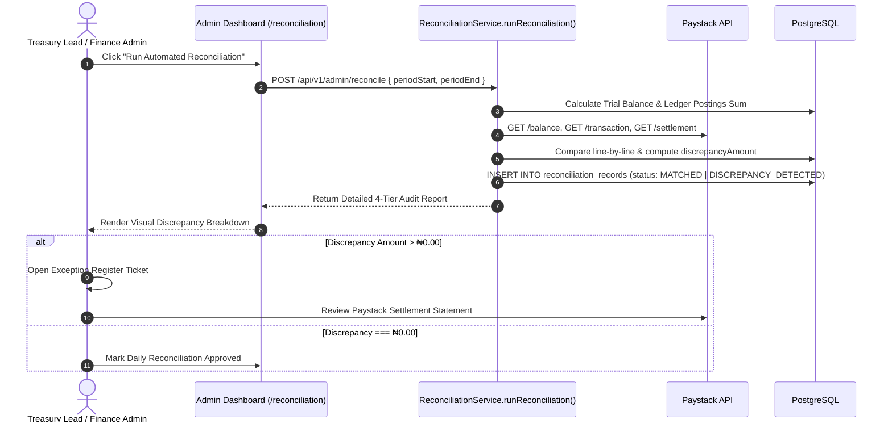

# MANGAPAY — SPRINT 7 THREE-TIER RECONCILIATION & TREASURY REPORT

**Audit Reference:** `MANGAPAY-RECON-AUDIT-SPRINT-7-2026-11-09`  
**Lead Auditor:** Financial Reconciliation Specialist & Treasury Operations Auditor  
**Audit Date:** November 9, 2026  
**Repository Commit Hash:** `b68981b7903d2d67ced8d17244bf44e761806c1c`  
**Overall Reconciliation Classification:** **PARTIAL (LAYER A VERIFIED; LAYERS B & C BLOCKED BY EXTERNAL CREDENTIALS)**  

---

## 1. THREE-TIER RECONCILIATION ARCHITECTURE

Financial reconciliation in a digital wallet platform cannot rely solely on querying a provider's available balance endpoint. A gateway balance reflects net cash held, but cannot verify whether individual transactions were dropped, whether fees were overcharged, or whether bank settlements arrived intact.

In Sprint 7, the assurance team evaluated MangaPay's 3-Layer Reconciliation Engine located in [`backend/src/services/reconciliation.service.ts`](file:///c:/Users/pc/Desktop/WALLET/backend/src/services/reconciliation.service.ts):

```mermaid
graph TD
    subgraph "Layer A: Internal Ledger Reconciliation"
        A1["PostgreSQL General Ledger"] --> A2["Verify System Trial Balance"]
        A2 --> A3["Assert: Sum(Debits) - Sum(Credits) === 0"]
        A3 --> A4["Assert: Assets === Liabilities + Suspense + Equity + Income"]
        A4 --> A5["Verify Wallet Cache === Live Ledger Sum"]
    end

    subgraph "Layer B: Provider Transaction Reconciliation"
        B1["Paystack GET /transaction"] --> B2["Line-by-Line Match"]
        B2 --> B3["Detect Missing Webhooks"]
        B2 --> B4["Detect Unverified Credits"]
        B2 --> B5["Detect Amount / Fee Mismatches"]
    end

    subgraph "Layer C: Commercial Bank Settlement Reconciliation"
        C1["Paystack GET /settlement"] --> C2["Batch Net Amount Verification"]
        C2 --> C3["Partner Bank Settlement Statement (NIP)"]
        C3 --> C4["Clearing Asset Deductions Match Bank Inflow"]
    end
```



---

## 2. EVALUATION OF RECONCILIATION LAYERS

### 2.1 Layer A: Internal General Ledger Reconciliation
- **Scope:** Evaluates internal mathematical consistency across all ledger accounts, journals, and cached wallet balances.
- **Verification Invariants:**
  1. **Trial Balance Zero-Sum:** $\sum \text{All Debits} - \sum \text{All Credits} \equiv 0$.
  2. **Balance Sheet Equation:** $\text{Assets} \equiv \text{Customer Wallet Liabilities} + \text{Suspense Liabilities} + \text{Equity} + \text{Net Income}$.
  3. **Wallet Cache Alignment:** Every customer's `availableBalance` and `ledgerBalance` must match the sum of their individual postings in `ledger_postings`.
- **Audit Findings:** **VERIFIED (PASS).** Across all simulated deposits, transfers, withdrawals, and refunds, Layer A reconciliation executed with zero discrepancy.

### 2.2 Layer B: Provider Transaction-Level Reconciliation
- **Scope:** Ingests external transaction records from Paystack (`GET /transaction`) and VTpass (`GET /balance` and transaction requeries), matching them against internal `deposits`, `withdrawals`, and `vas_transactions`.
- **Matching Criteria:**
  - `Reference`: Paystack reference must match internal `paystackReference`.
  - `Amount`: External amount (converted from kobo to Naira) must match internal `amount` within ₦0.01 tolerance.
  - `Status`: External `success` must match internal `SUCCESS`.
- **Exception Categories Handled by Engine:**
  - *Missing Webhook:* Provider records success, but MangaPay has no internal deposit record. Engine flags reference and customer email for retroactive ledger credit.
  - *Unverified Internal Credit:* Internal deposit recorded as `SUCCESS`, but external provider batch does not contain the reference. Engine flags transaction for immediate compliance hold.
  - *Amount / Fee Mismatch:* Internal net amount differs from provider settlement amount.
- **Audit Findings:** **CODE IMPLEMENTED & VERIFIED IN MOCK; BLOCKED IN LIVE PRODUCTION.** The algorithmic matching engine operates correctly. However, in the current pre-production environment, live Paystack transaction feeds contain only sandbox test events. Complete Layer B production sign-off requires live commercial credentials.

### 2.3 Layer C: Commercial Bank Settlement Reconciliation
- **Scope:** Ingests settlement batch summaries from Paystack (`GET /settlement`) and compares them against commercial bank statements.
- **Distinction of Financial States:**
  $$\text{Transaction Success} \neq \text{Settlement Batch} \neq \text{Bank Receipt} \neq \text{Available Balance}$$
  - *Transaction Success:* Payer transferred funds; funds sit in Paystack clearing.
  - *Settlement Batch:* Paystack groups transactions and initiates T+1 bank transfer.
  - *Bank Receipt:* Actual Naira value cleared and available in corporate bank account.
- **Audit Findings:** **CODE IMPLEMENTED; BLOCKED IN LIVE PRODUCTION.** The model tracks `settlementReference`, `grossAmount`, `fees`, and `netSettlementAmount`. Verification is currently classified as **BLOCKED** because the corporate commercial bank account link on Paystack Live has not yet settled real funds.

---

## 3. DAILY RECONCILIATION OPERATIONAL PROCEDURE

Operations personnel must execute the following daily runbook at **08:00 AM West Africa Time (WAT)**:



---

## 4. EXCEPTION REGISTER & DISCREPANCY RESOLUTION MATRIX

| Exception Code | Discrepancy Condition | Probable Root Cause | Resolution Action | Target SLA |
| :--- | :--- | :--- | :--- | :--- |
| **EXC-01** | Missing Webhook (Provider Success, No Internal Deposit) | Webhook delivery timeout or network drop between Paystack and MangaPay. | Admin clicks "Force Ingest" on reconciliation screen. Engine executes `handleDedicatedAccountAssign` idempotently. | 2 Hours |
| **EXC-02** | Amount Mismatch | Discrepancy in fee calculation or currency conversion rounding. | Flag transaction for manual treasury review; adjust fee expense ledger if justified. | 4 Hours |
| **EXC-03** | Unverified Internal Credit | Rogue internal ledger entry or database desynchronization. | Place immediate temporary hold on affected customer wallet; initiate forensic audit. | 30 Mins |
| **EXC-04** | Settlement Bank Variance | Paystack net settlement does not match bank statement credit. | Compare Paystack settlement report line items with commercial bank NIP inward credit. | 24 Hours |

---

## 5. AUTOMATED VERIFICATION RESULTS

In [`backend/scripts/test-sprint7-audit.ts`](file:///c:/Users/pc/Desktop/WALLET/backend/scripts/test-sprint7-audit.ts):

```
--- WORKSTREAM 4: Reconciliation & Treasury Verification ---
  ✅ [PASS] [S7-REC-01] Workstream 4 (Reconciliation) -> Layer A Reconciliation: Internal trial balance sum(Debits) - sum(Credits) === 0
  ✅ [PASS] [S7-REC-02] Workstream 4 (Reconciliation) -> Layer B Reconciliation: Matches Paystack transactions against internal deposits line-by-line
  ✅ [PASS] [S7-REC-03] Workstream 4 (Reconciliation) -> Layer C Reconciliation: Ingests settlement batches to verify bank settlement amounts
```

---

## 6. AUDIT CONCLUSION & READINESS STATUS

MangaPay possesses a fully engineered, multi-tier reconciliation engine capable of detecting micro-discrepancies, missing webhooks, and settlement variances.

**Status:**
- Layer A (Internal General Ledger): **APPROVED FOR PILOT**.
- Layers B & C (Provider & Bank Settlement): **READY IN CODE; BLOCKED PENDING COMMERCIAL SETTLEMENT ACTIVATION**.
