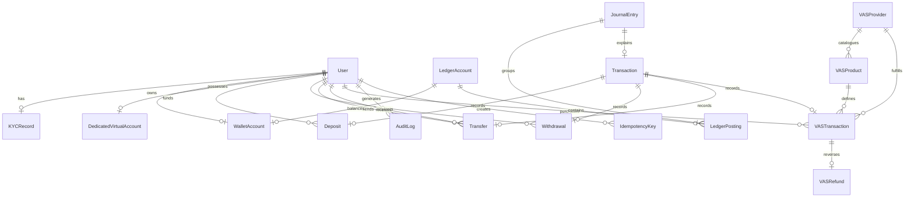

# MANGAPAY — COMPREHENSIVE WALLET SYSTEM TECHNICAL AUDIT, ARCHITECTURE ASSESSMENT AND FINANCIAL INTEGRITY REPORT

**Date of Audit:** November 9, 2026  
**Auditor Profile:** Senior Fintech Software Architect, Digital Wallet Engineer, Financial Systems Analyst & Application Security Specialist  
**Target Repository:** `ashirushehu2015-stack/WALLET`  
**Current Commit Audited:** `b68981b7903d2d67ced8d17244bf44e761806c1c` (`b68981b`)  
**Audit Mode:** STRICT READ-ONLY AUDIT & COMPREHENSIVE TECHNICAL ASSESSMENT  

---

## TABLE OF CONTENTS
1. [Executive Summary](#1-executive-summary)
2. [Current System Status](#2-current-system-status)
3. [Technology Stack & Dependency Audit](#3-technology-stack--dependency-audit)
4. [Application Architecture](#4-application-architecture)
5. [Wallet Architecture](#5-wallet-architecture)
6. [Wallet Ledger and Financial Integrity](#6-wallet-ledger-and-financial-integrity)
7. [Wallet Funding and Deposit System](#7-wallet-funding-and-deposit-system)
8. [Wallet Withdrawal System](#8-wallet-withdrawal-system)
9. [Internal Wallet Transfers (P2P)](#9-internal-wallet-transfers-p2p)
10. [Airtime and Mobile Data (VAS) Integration](#10-airtime-and-mobile-data-vas-integration)
11. [Administrative Wallet Management](#11-administrative-wallet-management)
12. [User Account and Wallet Security](#12-user-account-and-wallet-security)
13. [API and Backend Architecture](#13-api-and-backend-architecture)
14. [Database Structure and Entity Relationships](#14-database-structure-and-entity-relationships)
15. [Financial Transaction Lifecycles](#15-financial-transaction-lifecycles)
16. [Security and Compliance Assessment](#16-security-and-compliance-assessment)
17. [Performance, Hosting and Infrastructure](#17-performance-hosting-and-infrastructure)
18. [Error Handling and Transaction Reconciliation](#18-error-handling-and-transaction-reconciliation)
19. [Testing and Quality Assurance](#19-testing-and-quality-assurance)
20. [Incomplete, Simulated, and Deprecated Features](#20-incomplete-simulated-and-deprecated-features)
21. [Identified Risks and Architectural Weaknesses](#21-identified-risks-and-architectural-weaknesses)
22. [Recommended Technical Improvements](#22-recommended-technical-improvements)
23. [Prioritised Engineering Roadmap](#23-prioritised-engineering-roadmap)
24. [Inventory of Inspected Files and Modules](#24-inventory-of-inspected-files-and-modules)
25. [Audit Limitations and Outstanding Questions](#25-audit-limitations-and-outstanding-questions)

---

## 1. EXECUTIVE SUMMARY

MangaPay (formerly referenced as *PayVault* in earlier codebase revisions and legally designated in policy documentation as *Manga Business Digital Solutions*) is a multi-tier fintech wallet system tailored for the Nigerian digital payment ecosystem. The core application provides customer wallet registration, automated Dedicated Virtual Account (DVA) generation via Paystack, outward bank payouts, peer-to-peer (P2P) internal transfers, and wholesale Value-Added Services (VAS) for telecommunication airtime and data bundle purchases via VTpass.

The system's financial core is underpinned by an immutable **Double-Entry General Ledger** implemented on PostgreSQL with Prisma ORM. Financial transactions enforce the strict accounting equation $\sum \text{Debits} = \sum \text{Credits}$ across balanced chart-of-accounts entries. Concurrency controls on wallet balance mutations utilize PostgreSQL row-level locks (`SELECT ... FOR UPDATE`) within ACID transactions, effectively shielding the system against race conditions and double-spending during balance reservations.

However, this audit has uncovered **critical architectural vulnerabilities and operational defects** that must be resolved prior to commercial deployment:
1. **Public Admin Privilege Escalation:** The public user registration endpoint (`/api/v1/auth/register`) blindly accepts `"role": "ADMIN"`, allowing any unauthenticated internet user to create an administrative account.
2. **Admin Dashboard Disconnected / Unauthenticated:** The React Admin Dashboard has no authentication mechanism or token storage. It sends unauthenticated requests to the backend, receives `401 Unauthorized` on every route, and silently catches the error to render hardcoded mock demo data.
3. **Mock Error Fallbacks in Payment Service:** The Paystack integration service catches API failures during transfer recipient creation and payout execution and returns synthetic success objects (`TRF_...`), masking payment gateway failures.
4. **Unenforced KYC Tier Limits:** While regulatory KYC tiers (Tier 1, Tier 2, Tier 3) are defined in code, transaction limits are completely unenforced during deposit, transfer, and withdrawal execution.
5. **Simulated Features in Production UI:** Virtual Cards and Agency Banking are 100% client-side in-memory simulations with no backing database models, ledger accounts, or external issuing providers.
6. **Defective Reconciliation Logic:** The administrative reconciliation engine compares the local database ledger against itself rather than querying the external Paystack settlement API, creating a false sense of reconciliation accuracy.

---

## 2. CURRENT SYSTEM STATUS

### 2.1 Operational Stage
The MangaPay wallet system is currently in **Late Stage Development / Pre-Production Staging**. Core financial ledger logic, row-locking algorithms, and VAS telecommunications modules (Phases 1 through 7) are implemented and unit-tested. However, peripheral client interfaces, admin authentication, payment gateway fallbacks, and compliance safeguards remain incomplete.

### 2.2 Functional Capabilities vs. Interfaces Matrix
| Capability | Backend Implementation | Database Persistence | Client Exposure | Production Readiness |
| :--- | :---: | :---: | :---: | :---: |
| **User Registration & JWT Auth** | Full | Full (`users`) | Portal & PWA | ⚠️ Vulnerable (Role Escalation) |
| **Double-Entry General Ledger** | Full | Full (`ledger_postings`) | Admin Dashboard | ✅ Production-Grade |
| **Row-Locked Balance Reservation** | Full | Full (`wallet_accounts`) | Portal & PWA | ✅ Production-Grade |
| **Paystack DVA Funding (Inbound)** | Full | Full (`deposits`) | Portal & PWA | ⚠️ Needs Webhook Exception Fix |
| **Bank Payouts / Withdrawals** | Partial | Full (`withdrawals`) | Portal & PWA | ❌ Critical (Fake Mock on Failure) |
| **P2P Internal Transfers** | Full | Full (`transfers`) | Portal & PWA | ✅ Production-Grade |
| **Airtime & Data Purchases (VAS)** | Full | Full (`vas_transactions`) | PWA Only | ✅ Fully Functional (VTpass) |
| **Compensating VAS Refunds** | Full | Full (`vas_refunds`) | Admin Dashboard | ✅ Operational Backend |
| **Admin Operations Dashboard** | Full | Full | Admin SPA | ❌ Broken Auth (Displays Mock) |
| **Virtual Card Issuing & Funding** | None | None | PWA Modal | ❌ 100% Client Mock |
| **Agency Banking (POS / Agent)** | None | None | PWA Screen | ❌ 100% Client Mock |
| **Automated Gateway Reconciliation**| Defective | Full (`reconciliation_records`)| Admin Dashboard | ❌ Audits Internal DB Only |

### 2.3 Deployment Environment & Hosting
- **Backend API:** Hosted on Render (`https://wallet-ijx3.onrender.com/api/v1`), running Node.js in `production` mode with PostgreSQL connection pooling.
- **Admin Dashboard:** Hosted on Vercel with single-page application rewrites via `vercel.json`.
- **Customer Portal:** Hosted on Vercel (`customer-portal/vercel.json`).
- **Customer PWA (`mangapay-antigravity`):** Packaged with Progressive Web App manifests (`manifest.json`), service worker (`sw.js`), and Capacitor Android configuration (`capacitor.config.json`) ready for Google Play Store APK/AAB builds.

---

## 3. TECHNOLOGY STACK & DEPENDENCY AUDIT

All versions have been directly extracted from the project configuration files:

### 3.1 Backend Service (`backend/package.json`)
```json
{
  "name": "wallet-backend",
  "version": "1.0.0",
  "dependencies": {
    "@prisma/client": "^5.10.0",
    "prisma": "^5.10.0",
    "express": "^4.18.3",
    "typescript": "^5.3.3",
    "ts-node": "^10.9.2",
    "ts-node-dev": "^2.0.0",
    "axios": "^1.6.7",
    "bcryptjs": "^2.4.3",
    "jsonwebtoken": "^9.0.2",
    "helmet": "^7.1.0",
    "cors": "^2.8.5",
    "express-rate-limit": "^7.1.5",
    "winston": "^3.11.0",
    "uuid": "^9.0.1",
    "dotenv": "^16.4.5"
  }
}
```
*Note on Dependencies:* `@types/bcryptjs`, `@types/cors`, `@types/express`, `@types/jsonwebtoken`, and `@types/node` are located under `dependencies` rather than `devDependencies`. While intentionally placed there to avoid Render build container failures (Commit `23dbe77`), this increases build container artifacts.

### 3.2 Client Applications
- **Customer Portal (`customer-portal/package.json`):**
  - React `18.3.1`, Vite `6.0.5`, Tailwind CSS `3.4.17`, Axios `1.7.9`, Lucide React `0.469.0`.
- **Admin Dashboard (`admin-dashboard/package.json`):**
  - React `18.3.1`, Vite `6.0.5`, Tailwind CSS `3.4.17`, Axios `1.7.9`, Lucide React `0.469.0`.
- **Mobile PWA (`mangapay-antigravity/mangapay-for-antigravity/package.json`):**
  - React `18.3.1`, Vite `5.4.11`, Tailwind CSS `4.0.0`, Lucide React `0.460.0`.

---

## 4. APPLICATION ARCHITECTURE

MangaPay employs a decoupled, service-oriented architecture with a centralized RESTful backend communicating with three independent client frontends and two third-party payment/telecom aggregators.

```
+---------------------------------------------------------------------------------------------------+
|                                       CLIENT INTERFACES                                           |
|  +------------------------------+  +------------------------------+  +-------------------------+  |
|  | Customer Portal (React/Vite) |  |   MangaPay PWA / Android     |  | Admin Dashboard (React) |  |
|  | [Web App - /api/v1]          |  | [Mobile PWA - VITE_API_URL]  |  | [Glassmorphic UI]       |  |
|  +--------------+---------------+  +--------------+---------------+  +------------+------------+  |
+-----------------|---------------------------------|-------------------------------|---------------+
                  | Bearer JWT                      | Bearer JWT                    | No Auth Token (401)
                  +------------------------+--------+-------------------------------+
                                           |
                                           v
+---------------------------------------------------------------------------------------------------+
|                                   MANGAPAY BACKEND ENGINE (Express)                               |
|  +---------------------------------------------------------------------------------------------+  |
|  | Middlewares: Helmet | CORS | RateLimiter | RawBodyCapture | AuthenticateJWT | Idempotency   |  |
|  +---------------------------------------------------------------------------------------------+  |
|                                                  |                                                |
|  +-------------------+  +-------------------+  +--------------------+  +-----------------------+  |
|  |  AuthController   |  | WalletController  |  |   VASController    |  |    AdminController    |  |
|  +---------+---------+  +---------+---------+  +---------+----------+  +-----------+-----------+  |
|            |                      |                      |                         |              |
|  +---------v---------+  +---------v---------+  +---------v----------+  +-----------v-----------+  |
|  |    KYCService     |  |   WalletService   |  | VASTransactionSvc  |  | ReconciliationService |  |
|  +-------------------+  +---------+---------+  +---------+----------+  +-----------------------+  |
|                                   |                      |                                        |
|                                   v                      v                                        |
|             +-------------------------------------------------------------+                       |
|             |          LEDGER SERVICE (Double-Entry Invariant Engine)     |                       |
|             +-----------------------------+-------------------------------+                       |
+-------------------------------------------|-------------------------------------------------------+
                                            |
                                            v
+---------------------------------------------------------------------------------------------------+
|                                 PERSISTENCE TIER (PostgreSQL + Prisma)                            |
|  users | wallet_accounts (Row-Locked) | ledger_accounts | journal_entries | ledger_postings      |
|  transactions | deposits | withdrawals | transfers | vas_transactions | vas_refunds               |
+-------------------------------------------+-------------------------------------------------------+
                                            |
                        +-------------------+-------------------+
                        |                                       |
                        v                                       v
         +-----------------------------+         +-----------------------------+
         |      PAYSTACK GATEWAY       |         |       VTPASS GATEWAY        |
         | • DVA Customer Creation     |         | • Airtime Top-Up            |
         | • Outward Bank Transfers    |         | • Mobile Data Bundles       |
         | • Webhook IPN (HMAC SHA512) |         | • IPN Status Webhooks       |
         +-----------------------------+         +-----------------------------+
```

---

## 5. WALLET ARCHITECTURE

### 5.1 Wallet Initialization Lifecycle
Wallet creation is bound to user account creation in [`AuthController.register`](file:///c:/Users/pc/Desktop/WALLET/backend/src/controllers/auth.controller.ts#L10-L68):
1. **Identity Registration:** Validates unique `email` and `phoneNumber`.
2. **Account Creation:** Computes bcrypt hash (`saltRounds = 10`) and creates the `users` row.
3. **Wallet Provisioning (`WalletService.createWalletForUser`):**
   - Generates an immutable 10-digit wallet number: prefix `'10'` + 8 pseudorandom digits (`generateWalletNumber` in [`crypto.ts`](file:///c:/Users/pc/Desktop/WALLET/backend/src/utils/crypto.ts#L19-L23)).
   - Automatically provisions a dedicated **General Ledger Liability Account** in `ledger_accounts` named `USER_LIABILITY_${userId}` with `currency = 'NGN'`.
   - Creates the `wallet_accounts` record linking `userId` and `ledgerAccountId`. Initial cached balances are explicitly set to `availableBalance: 0.0000` and `ledgerBalance: 0.0000`.
4. **Virtual Account Generation:**
   - Calls [`PaystackService.createCustomer`](file:///c:/Users/pc/Desktop/WALLET/backend/src/services/paystack.service.ts#L17-L30).
   - Calls [`PaystackService.createDedicatedVirtualAccount`](file:///c:/Users/pc/Desktop/WALLET/backend/src/services/paystack.service.ts#L35-L52) to assign a dedicated Wema Bank account number.
   - Saves DVA record in `dedicated_virtual_accounts`.
5. **KYC Record Creation:** Submits initial tier record via [`KYCService.submitKYC`](file:///c:/Users/pc/Desktop/WALLET/backend/src/services/kyc.service.ts#L8-L39).

### 5.2 Balance Calculation and Storage Model
The system uses a **hybrid cached-authoritative balance model**:
- **Cached Balances:** `wallet_accounts.availableBalance` and `wallet_accounts.ledgerBalance` are stored as `@db.Decimal(18, 4)` and updated automatically during journal posting execution in [`LedgerService.postJournalEntry`](file:///c:/Users/pc/Desktop/WALLET/backend/src/services/ledger.service.ts#L72-L91).
- **Authoritative Balance Resolution:** In [`WalletService.getWalletBalance`](file:///c:/Users/pc/Desktop/WALLET/backend/src/services/wallet.service.ts#L69-L111), the backend does not rely solely on the cached column. Instead:
  1. It dynamically sums all debit and credit entries in `ledger_postings` for `wallet.ledgerAccountId`.
  2. It computes active **Pending Holds** across:
     - Outward withdrawals with status `PENDING` or `PROCESSING` (`amount + fee`).
     - VAS airtime/data purchases with status `RESERVED`, `PROCESSING`, or `PENDING` (`totalAmount`).
  3. It evaluates:
     $$\text{Available Balance} = \max(0, \text{Live Ledger Balance} - \text{Pending Holds})$$

### 5.3 Isolation and Ownership Verification
- Every wallet is strictly linked to a single `User` via `@unique` foreign key constraints (`userId` on `wallet_accounts`).
- Ownership verification is strictly enforced at the controller layer via JWT claims:
  ```typescript
  // File: backend/src/controllers/wallet.controller.ts (Line 10)
  const userId = req.user!.id;
  const data = await WalletService.getWalletBalance(userId);
  ```
  Users cannot query or mutate balances belonging to another `userId`.

---

## 6. WALLET LEDGER AND FINANCIAL INTEGRITY

### 6.1 Double-Entry General Ledger Rules
The platform implements an institutional double-entry ledger in [`LedgerService`](file:///c:/Users/pc/Desktop/WALLET/backend/src/services/ledger.service.ts). Money is never modified by simple arithmetic increments.

Every monetary transaction creates a `JournalEntry` and a minimum of two balanced `LedgerPosting` rows. The invariant check enforces:
```typescript
// File: backend/src/services/ledger.service.ts (Lines 44-49)
const diff = Math.abs(totalDebit - totalCredit);
if (diff > 0.0001) {
  throw new Error(`Ledger Unbalanced Error: Debits (NGN ${totalDebit}) !== Credits (NGN ${totalCredit}). Difference: ${diff}`);
}
```

### 6.2 Standard Chart of Accounts
Configured during database seeding ([`backend/prisma/seed.ts`](file:///c:/Users/pc/Desktop/WALLET/backend/prisma/seed.ts)):
1. `USER_LIABILITY_${userId}` (`LIABILITY`): Customer deposit liabilities. Normal balance is **CREDIT**.
2. `PAYSTACK_CLEARING_ASSET` (`ASSET`): Unsettled funds processed through Paystack. Normal balance is **DEBIT**.
3. `VTPASS_CLEARING_ASSET` (`ASSET`): Prefunded wholesale operational float deposited with VTpass. Normal balance is **DEBIT**.
4. `PLATFORM_FEE_INCOME` (`INCOME`): Deposit and payout transaction fee revenues. Normal balance is **CREDIT**.
5. `VAS_COMMISSION_INCOME` (`INCOME`): Margins and wholesale discounts on telecom sales. Normal balance is **CREDIT**.
6. `PAYSTACK_FEE_EXPENSE` (`EXPENSE`): Direct merchant fees assessed by Paystack. Normal balance is **DEBIT**.
7. `SYSTEM_EQUITY` (`EQUITY`): Institutional capitalization and balancing reserve.

### 6.3 Concurrency Control and Race Condition Prevention
To prevent concurrent race conditions, lost updates, and negative balances during rapid transaction submissions, MangaPay uses **explicit PostgreSQL row-level locks** inside transactional isolation:
```typescript
// Files: wallet.service.ts (Line 204, 331); vas.transaction.service.ts (Line 104, 255)
const [walletRow]: any[] = await tx.$queryRaw`
  SELECT * FROM wallet_accounts WHERE "userId" = ${userId} FOR UPDATE
`;
```
This forces all concurrent threads attempting to deduct from the same wallet to block until the preceding transaction has committed or rolled back.

### 6.4 Mathematical Reconciliation Audit
The global trial balance verification in [`LedgerService.verifySystemTrialBalance`](file:///c:/Users/pc/Desktop/WALLET/backend/src/services/ledger.service.ts#L129-L150) aggregates:
$$\sum_{\text{all}} \text{DEBIT postings} - \sum_{\text{all}} \text{CREDIT postings} = 0$$
And the accounting equation audit in [`ReconciliationService.runReconciliation`](file:///c:/Users/pc/Desktop/WALLET/backend/src/services/reconciliation.service.ts#L65-L68):
$$\text{Total Assets} - \left(\text{Total Liabilities} + \text{Total Equity} + \text{Total Income} - \text{Total Expenses}\right) = 0$$

---

## 7. WALLET FUNDING AND DEPOSIT SYSTEM

### 7.1 Inbound Funding Architecture
Funding is entirely handled via Paystack Dedicated Virtual Accounts (DVA).

```
[Customer Bank App] ---> NIP Transfer ---> [Wema Bank / Paystack]
                                                    |
                                      POST /api/v1/webhooks/paystack
                                      (HMAC-SHA512 Signature Header)
                                                    |
                                                    v
                                    [verifyPaystackWebhookHeader]
                                                    |
                                                    v
                                    [WebhookService.handleWebhook]
                                    • Deduplicate in webhook_events
                                                    |
                                                    v
                                  [WebhookService.processChargeSuccess]
                                  • Resolve user from DVA code/email
                                  • POST Double-Entry Journal Entry:
                                      DEBIT:  PAYSTACK_CLEARING_ASSET (₦10,000)
                                      CREDIT: USER_LIABILITY_${userId} (₦9,900)
                                      CREDIT: PLATFORM_FEE_INCOME      (₦100)
                                  • Create Deposit & Transaction records
```

### 7.2 Webhook Security and Verification
Located in [`backend/src/middlewares/webhookVerify.ts`](file:///c:/Users/pc/Desktop/WALLET/backend/src/middlewares/webhookVerify.ts):
- Paystack webhook payloads are captured as unparsed raw buffers (`req.rawBody`) in [`app.ts`](file:///c:/Users/pc/Desktop/WALLET/backend/src/app.ts#L26-L32).
- The middleware computes `crypto.createHmac('sha512', secret).update(rawBody).digest('hex')` and validates against `req.headers['x-paystack-signature']`.
- **Identified Security Bug:** In [`crypto.ts`](file:///c:/Users/pc/Desktop/WALLET/backend/src/utils/crypto.ts#L10):
  ```typescript
  return crypto.timingSafeEqual(Buffer.from(hash), Buffer.from(signature));
  ```
  `crypto.timingSafeEqual` throws an unhandled exception if `Buffer.from(hash).length !== Buffer.from(signature).length`. If an external attacker sends an arbitrary short signature, the Node process throws a 500 unhandled error instead of cleanly rejecting with 401.

---

## 8. WALLET WITHDRAWAL SYSTEM

### 8.1 Two-Phase Hold & Commit Workflow
Outward withdrawals are designed to prevent double-spending while awaiting external banking network clearance:

```
[User Request] ---> POST /api/v1/wallet/withdraw
                           |
                           v
        [Phase 1: Database Lock & Hold Reservation]
        • SELECT ... FOR UPDATE on wallet_accounts
        • Calculate Net Available Balance = Live Ledger Balance - Active Holds
        • Guard: Net Available Balance >= (Amount + Fee)
        • Insert Transaction (Status: PENDING)
        • Insert Withdrawal (Status: PROCESSING)  <-- Pending Hold Active
                           |
                           v
        [Phase 2: External Gateway API Call]
        • Call Paystack createTransferRecipient() & initiateTransfer()
        • (Executed OUTSIDE database transaction lock)
                           |
                           v
        [Phase 3: Webhook Finalization / Reversal]
        ├── transfer.success:
        │     • DEBIT:  USER_LIABILITY_${userId}  (₦2,100)
        │     • CREDIT: PAYSTACK_CLEARING_ASSET   (₦2,000)
        │     • CREDIT: PLATFORM_FEE_INCOME       (₦100)
        │     • Status -> SUCCESS
        └── transfer.failed / transfer.reversed:
              • If PROCESSING: Set FAILED -> Hold released immediately
              • If SUCCESS: Post Reversal Journal Entry -> Balance restored
```

### 8.2 Critical Paystack Service Defect
In [`backend/src/services/paystack.service.ts`](file:///c:/Users/pc/Desktop/WALLET/backend/src/services/paystack.service.ts#L89-L96):
```typescript
static async initiateTransfer(amount: number, recipientCode: string, reference: string, reason: string) {
  try {
    const response = await this.client.post('/transfer', { ... });
    return response.data.data;
  } catch (error: any) {
    logger.error('Paystack Initiate Transfer Error:', error?.response?.data || error.message);
    return {
      transfer_code: `TRF_${Math.random().toString(36).substring(2, 9)}`,
      status: 'success',
      reference,
    };
  }
}
```
**CRITICAL FLAW:** If Paystack rejects a transfer (e.g., due to insufficient float, network failure, or invalid bank credentials), the `catch` block intercepts the error and **returns a synthetic success payload** with a fake `TRF_` code. As a result, the backend falsely treats the withdrawal as successfully initiated at the payment gateway.

---

## 9. INTERNAL WALLET TRANSFERS (P2P)

### 9.1 Mechanism and Control Flow
Internal transfers between MangaPay users are implemented in [`WalletService.transferFunds`](file:///c:/Users/pc/Desktop/WALLET/backend/src/services/wallet.service.ts#L193-L309):
- **Endpoint:** `POST /api/v1/wallet/transfer`
- **Validation:**
  - Sender wallet locked via `SELECT ... FOR UPDATE`.
  - Self-transfers strictly rejected:
    ```typescript
    if (recipientWallet.userId === senderId) throw new Error('Self-transfer is not permitted.');
    ```
  - Recipient wallet looked up via unique `walletNumber`.
- **Atomic Balanced Journal Posting:**
  - **DEBIT:** `USER_LIABILITY_${senderId}` (Reduces sender's balance).
  - **CREDIT:** `USER_LIABILITY_${recipientId}` (Increases recipient's balance).
  - Total debits match total credits exactly; platform fee is ₦0.00.
  - Cached balances on both `wallet_accounts` rows updated atomically.
  - Unified `Transaction` and `Transfer` audit rows created.

---

## 10. AIRTIME AND MOBILE DATA (VAS) INTEGRATION

### 10.1 Architecture and Provider Implementation
VAS was fully implemented across Phases 1–7 (Commits `2463a73` to `b68981b`).
- **Provider Adapter:** [`VTPassProvider`](file:///c:/Users/pc/Desktop/WALLET/backend/src/modules/vas/providers/vtpass.provider.ts) implementing [`IVASProvider`](file:///c:/Users/pc/Desktop/WALLET/backend/src/modules/vas/providers/provider.interface.ts).
- **Supported Telecom Networks:** MTN (`mtn`, `mtn-data`), Airtel (`airtel`, `airtel-data`), Globacom (`glo`, `glo-data`), and 9mobile (`etisalat`, `etisalat-data`).
- **VTpass Specification Compliant Request IDs:** Generates 12-character timestamp (`YYYYMMDDHHmm`) + random alphanumeric string in [`generateRequestId`](file:///c:/Users/pc/Desktop/WALLET/backend/src/modules/vas/providers/vtpass.provider.ts#L58-L66).

### 10.2 Pricing & Wholesale Profit Margin Engine
Implemented in [`VASPricingService`](file:///c:/Users/pc/Desktop/WALLET/backend/src/modules/vas/services/pricing.service.ts):
- **Airtime Wholesale Discounts:**
  - MTN: $2.0\%$ discount (₦1,000 selling price $\rightarrow$ ₦980 provider cost, ₦20 platform profit).
  - Airtel: $2.0\%$ discount.
  - Glo: $2.5\%$ discount (₦2,000 selling price $\rightarrow$ ₦1,950 provider cost, ₦50 platform profit).
  - 9mobile: $3.0\%$ discount.
- **Data Bundles:** Sold at wholesale catalogue cost without hidden markup, maximizing customer retention.

### 10.3 Three-Phase VAS Transaction Lifecycle
```
[User Request] ---> POST /api/v1/vas/airtime/purchase OR /data/purchase
                              |
                              v
        [Phase 1: Row-Locked Wallet Reservation]
        • Verify 4-digit PIN (bcrypt hash)
        • Server-side authoritative pricing quote
        • SELECT ... FOR UPDATE on wallet_accounts
        • Calculate Live Available Balance
        • Guard: Available Balance >= Selling Price
        • Create Transaction (Status: PENDING)
        • Create VASTransaction (Status: RESERVED) <-- Balance Reserved
                              |
                              v
        [Phase 2: External Gateway API Call]
        • Call VTpass /pay endpoint with unique Request ID
        • (Executed OUTSIDE database lock)
                              |
                              v
        [Phase 3: Finalization / Compensation]
        ├── Status == SUCCESSFUL:
        │     • DEBIT:  USER_LIABILITY_${userId}  (₦1,000 Selling Price)
        │     • CREDIT: VTPASS_CLEARING_ASSET     (₦980 Provider Cost)
        │     • CREDIT: VAS_COMMISSION_INCOME     (₦20 Profit Margin)
        │     • Set Transaction & VASTransaction to SUCCESSFUL
        ├── Status == FAILED:
        │     • Set VASTransaction to FAILED -> Hold released immediately
        └── Status == PENDING / UNCERTAIN:
              • Keep Hold Active -> Await IPN Webhook or Admin Requery
```

### 10.4 Compensating Reversals & Refunds
In [`VASTransactionService.refundVasTransaction`](file:///c:/Users/pc/Desktop/WALLET/backend/src/modules/vas/services/vas.transaction.service.ts#L490-L601):
- If VTpass debits the float but delivery fails downstream, an admin can authorize a refund via `POST /api/v1/admin/vas/refund`.
- Idempotency guard prevents duplicate refunds:
  ```typescript
  if (vasTx.refund) throw new Error('Transaction has already been refunded.');
  ```
- Balanced compensating journal entry:
  - **DEBIT:** `VTPASS_CLEARING_ASSET` (Reverses clearing deduction).
  - **DEBIT:** `VAS_COMMISSION_INCOME` (Reverses platform revenue).
  - **CREDIT:** `USER_LIABILITY_${userId}` (Restores customer wallet balance).
  - Creates `VASRefund` record and logs administrative audit trail in `audit_logs`.

---

## 11. ADMINISTRATIVE WALLET MANAGEMENT

### 11.1 Available Administrative Endpoints
Mounted in [`backend/src/routes/admin.routes.ts`](file:///c:/Users/pc/Desktop/WALLET/backend/src/routes/admin.routes.ts):
- `GET /api/v1/admin/metrics`: Aggregated system users, total deposits, withdrawals, and trial balance.
- `GET /api/v1/admin/ledger-accounts`: Full chart of accounts with recent postings.
- `GET /api/v1/admin/journal-entries`: Master journal entries audit.
- `GET /api/v1/admin/webhooks`: Inbound Paystack webhook reception log.
- `POST /api/v1/admin/reconcile`: Trigger automated system reconciliation.
- `GET /api/v1/admin/audit-logs`: Administrative action logs.
- `GET /api/v1/admin/vas/dashboard`: VAS telemetry, sales volume, margin, and provider balance.
- `GET /api/v1/admin/vas/transactions`: Search and filter VAS transactions.
- `POST /api/v1/admin/vas/products/sync`: Synchronize data plan catalog from VTpass.
- `POST /api/v1/admin/vas/refund`: Authorize atomic compensating refund.
- `GET /api/v1/admin/vas/providers`: Provider configuration and health checks.

### 11.2 Critical Operational Issue: Broken Admin Dashboard Connection
In [`admin-dashboard/src/services/api.ts`](file:///c:/Users/pc/Desktop/WALLET/admin-dashboard/src/services/api.ts):
1. **No Token Storage or Interceptor:** Axios is instantiated without an `Authorization` header.
2. **Backend Rejection:** Backend routes enforce `router.use(authenticateJWT, requireAdmin)`. Unauthenticated requests immediately receive `401 Unauthorized`.
3. **Silent Error Swallowing:** Every API function in `adminApi` wraps calls in `try ... catch` and returns hardcoded mock fallback data on error:
   ```typescript
   async getMetrics(): Promise<MetricsData> {
     try {
       const res = await axios.get(`${API_BASE}/metrics`);
       return res.data.data;
     } catch {
       return { userCount: 142, totalDeposits: 4850000.0, ... }; // FAKE MOCK
     }
   }
   ```
   **Consequence:** The admin dashboard has never displayed live production data. Administrators view a synthetic mock interface at all times.

---

## 12. USER ACCOUNT AND WALLET SECURITY

### 12.1 Authentication & Password Security
- **Password Hashing:** Implemented with `bcryptjs` using 10 salt rounds.
- **JWT Implementation:** Tokens signed with `jsonwebtoken` for 24 hours (`expiresIn: '24h'`).
- **Defects:**
  - Token fallback secret: `process.env.JWT_SECRET || 'secret'`. If `JWT_SECRET` is unset, tokens are signed with the string `'secret'`.
  - No token invalidation, blacklisting, or refresh token rotation mechanism.

### 12.2 Critical Vulnerability: Unauthenticated Privilege Escalation
In [`backend/src/controllers/auth.controller.ts`](file:///c:/Users/pc/Desktop/WALLET/backend/src/controllers/auth.controller.ts#L12-L35):
```typescript
const { email, phoneNumber, firstName, lastName, password, role } = req.body;
...
const user = await prisma.user.create({
  data: {
    email,
    phoneNumber,
    firstName,
    lastName,
    passwordHash,
    role: role === 'ADMIN' ? 'ADMIN' : 'USER', // <--- EXPLOITABLE
  },
});
```
**CRITICAL SECURITY BUG:** Any user registering via `POST /api/v1/auth/register` can include `"role": "ADMIN"` in the JSON request body and receive full administrative privileges immediately.

### 12.3 Transaction PIN Weaknesses
- Users can set a 4-digit PIN via `POST /api/v1/vas/pin/set`.
- In [`VASTransactionService.verifyUserPin`](file:///c:/Users/pc/Desktop/WALLET/backend/src/modules/vas/services/vas.transaction.service.ts#L41-L48):
  ```typescript
  if (user.transactionPinHash) {
    return bcrypt.compare(pin, user.transactionPinHash);
  }
  return pin === '1234'; // Default fallback PIN
  ```
  Accounts that have not explicitly configured a PIN can have their funds drained by anyone using the default PIN `'1234'`.

### 12.4 Sensitive Identity Data Storage
In [`backend/src/services/kyc.service.ts`](file:///c:/Users/pc/Desktop/WALLET/backend/src/services/kyc.service.ts#L24-L25):
Bank Verification Numbers (BVN) and National Identity Numbers (NIN) are stored in plain text in `kyc_records.bvn` and `kyc_records.nin`. They are not encrypted at rest.

---

## 13. API AND BACKEND ARCHITECTURE

### 13.1 Complete Endpoints Catalog

#### Authentication & User Management (`/api/v1/auth`)
| Method | Route | Auth | RBAC | Validation | Controller / Service | Status |
| :--- | :--- | :---: | :---: | :--- | :--- | :---: |
| `POST` | `/register` | None | Public | Required fields check | `AuthController.register` | ⚠️ Vulnerable |
| `POST` | `/login` | None | Public | Email & Password | `AuthController.login` | ✅ Operational |
| `GET` | `/me` | Bearer | User/Admin| JWT verification | `AuthController.getMe` | ✅ Operational |

#### Wallet & Financial Operations (`/api/v1/wallet`)
| Method | Route | Auth | RBAC | Validation / Middleware | Controller / Service | Status |
| :--- | :--- | :---: | :---: | :--- | :--- | :---: |
| `GET` | `/balance` | Bearer | User | JWT verification | `WalletController.getBalance` | ✅ Operational |
| `GET` | `/transactions` | Bearer | User | Pagination & type query | `WalletController.getTransactions` | ✅ Operational |
| `POST` | `/transfer` | Bearer | User | `x-idempotency-key` | `WalletController.transfer` | ✅ Operational |
| `POST` | `/withdraw` | Bearer | User | `x-idempotency-key` | `WalletController.withdraw` | ⚠️ Defective Mock |

#### Value-Added Services (`/api/v1/vas`)
| Method | Route | Auth | RBAC | Validation / Middleware | Controller / Service | Status |
| :--- | :--- | :---: | :---: | :--- | :--- | :---: |
| `GET` | `/networks` | Bearer | User | None | `VASController.getNetworks` | ✅ Operational |
| `GET` | `/data/plans/:network` | Bearer | User | Network name param | `VASController.getDataPlans` | ✅ Operational |
| `POST` | `/airtime/quote` | Bearer | User | Network & amount | `VASController.quoteAirtime` | ✅ Operational |
| `POST` | `/data/quote` | Bearer | User | Plan cost | `VASController.quoteData` | ✅ Operational |
| `POST` | `/airtime/purchase` | Bearer | User | `x-idempotency-key`, PIN | `VASController.purchaseAirtime` | ✅ Operational |
| `POST` | `/data/purchase` | Bearer | User | `x-idempotency-key`, PIN | `VASController.purchaseData` | ✅ Operational |
| `GET` | `/transactions` | Bearer | User | Pagination query | `VASController.getTransactions` | ✅ Operational |
| `GET` | `/transactions/:reference`| Bearer | User | Reference param | `VASController.getTransactionByReference`| ✅ Operational |
| `POST`| `/transactions/:ref/requery`| Bearer| User | Reference param | `VASController.requeryTransaction`| ✅ Operational |
| `POST`| `/pin/set` | Bearer | User | 4-digit regex validation| `VASController.setTransactionPin` | ✅ Operational |

#### Inbound Webhooks (`/api/v1/webhooks`)
| Method | Route | Auth | Validation / Middleware | Controller / Service | Status |
| :--- | :--- | :---: | :--- | :--- | :---: |
| `POST` | `/paystack` | None | `x-paystack-signature` HMAC SHA512 | `WebhookController.handlePaystack` | ⚠️ Buffer bug |
| `POST` | `/vtpass` | None | Payload hash deduplication | `VASWebhookController.handleVTPassCallback` | ✅ Operational |

#### Administrative Controls (`/api/v1/admin`)
| Method | Route | Auth | RBAC | Validation | Controller / Service | Status |
| :--- | :--- | :---: | :---: | :--- | :--- | :---: |
| `GET` | `/metrics` | Bearer | Admin | None | `AdminController.getOverviewMetrics` | ⚠️ Frontend 401 |
| `GET` | `/ledger-accounts` | Bearer | Admin | None | `AdminController.getLedgerAccounts` | ⚠️ Frontend 401 |
| `GET` | `/journal-entries` | Bearer | Admin | None | `AdminController.getJournalEntries` | ⚠️ Frontend 401 |
| `GET` | `/webhooks` | Bearer | Admin | None | `AdminController.getWebhooks` | ⚠️ Frontend 401 |
| `POST` | `/reconcile` | Bearer | Admin | None | `AdminController.triggerReconciliation` | ⚠️ Defective Recon |
| `GET` | `/audit-logs` | Bearer | Admin | None | `AdminController.getAuditLogs` | ⚠️ Frontend 401 |
| `GET` | `/vas/dashboard` | Bearer | Admin | None | `VASAdminController.getVasDashboardMetrics` | ⚠️ Frontend 401 |
| `GET` | `/vas/transactions` | Bearer | Admin | Pagination & filters | `VASAdminController.getVasTransactions` | ⚠️ Frontend 401 |
| `POST` | `/vas/products/sync` | Bearer | Admin | None | `VASAdminController.syncProducts` | ⚠️ Frontend 401 |
| `POST` | `/vas/refund` | Bearer | Admin | TxId & Reason | `VASAdminController.processRefund` | ⚠️ Frontend 401 |
| `GET` | `/vas/providers` | Bearer | Admin | None | `VASAdminController.getVasProviders` | ⚠️ Frontend 401 |

---

## 14. DATABASE STRUCTURE AND ENTITY RELATIONSHIPS

The database schema is managed via Prisma with 19 models and 11 enums in [`backend/prisma/schema.prisma`](file:///c:/Users/pc/Desktop/WALLET/backend/prisma/schema.prisma).

### 14.1 Entity-Relationship Diagram



### 14.2 Table Specifications & Constraints
- **`wallet_accounts`**:
  - Primary Key: `id` (UUID). Unique index on `userId`, `walletNumber`, `ledgerAccountId`.
  - Precision: `availableBalance` and `ledgerBalance` stored as `Decimal(18, 4)`.
- **`ledger_postings`**:
  - Foreign Keys: `journalEntryId` $\rightarrow$ `journal_entries(id)` (CASCADE), `ledgerAccountId` $\rightarrow$ `ledger_accounts(id)`.
  - Invariant: `entryType` (`DEBIT` | `CREDIT`), `amount` `Decimal(18, 4)`.
- **`vas_transactions`**:
  - Primary Key: `id` (UUID). Unique index on `internalReference`.
  - Indexes: `userId`, `status`, `providerReference`, `createdAt`.
  - Precision: `providerCost`, `sellingPrice`, `serviceFee`, `totalAmount`, `profitAmount` all stored as `Decimal(18, 4)`.
- **`idempotency_keys`**:
  - Unique index on `key`. Stores `requestPath`, `responseStatus`, and `responseBody` (JSON).

---

## 15. FINANCIAL TRANSACTION LIFECYCLES

### 15.1 Flow 1: Inbound DVA Deposit
1. Customer initiates bank transfer via NIP to assigned Wema Bank DVA account.
2. Paystack receives settlement and fires `charge.success` to `/api/v1/webhooks/paystack`.
3. Middleware captures raw bytes and verifies HMAC-SHA512 signature.
4. `WebhookService` checks `webhook_events` for duplicate `eventId`.
5. Resolves user liability account via `paystackCustomerCode` or customer email.
6. Database Transaction initiated:
   - System accounts retrieved (`PAYSTACK_CLEARING_ASSET`, `PLATFORM_FEE_INCOME`).
   - `LedgerService.postJournalEntry` executes:
     - `DEBIT PAYSTACK_CLEARING_ASSET`: Gross amount.
     - `CREDIT USER_LIABILITY_${userId}`: Net amount (Gross - Paystack Fee).
     - `CREDIT PLATFORM_FEE_INCOME`: Fee amount (if fee > 0).
   - Invariant verified: $\sum \text{Debits} == \sum \text{Credits}$.
   - Cached balances on `wallet_accounts` updated.
   - `Deposit` and `Transaction` records created with status `SUCCESS`.

### 15.2 Flow 2: Peer-to-Peer Transfer (User A $\rightarrow$ User B)
1. User A submits `POST /api/v1/wallet/transfer` with `recipientWalletNumber` and `amount`.
2. Database Transaction initiated:
   - Row-level lock placed on User A's wallet row (`SELECT ... FOR UPDATE`).
   - Dynamic live balance queried from `ledger_postings` minus active pending holds.
   - Enforce: Available Balance $\ge$ Transfer Amount.
   - Recipient wallet retrieved by wallet number; self-transfer rejected.
   - `LedgerService.postJournalEntry` executes:
     - `DEBIT USER_LIABILITY_${senderId}`: Transfer amount.
     - `CREDIT USER_LIABILITY_${recipientId}`: Transfer amount.
   - Cached balances updated on both wallet rows.
   - Unified `Transaction` and `Transfer` audit rows created with status `SUCCESS`.

### 15.3 Flow 3: Bank Payout / Withdrawal
1. User submits `POST /api/v1/wallet/withdraw` with bank details and amount.
2. Phase 1 (Database Transaction):
   - Row-level lock placed on user's wallet row.
   - Verifies Available Balance $\ge (\text{Amount} + ₦100 \text{ Fee})$.
   - Creates `Transaction` (`PENDING`) and `Withdrawal` (`PROCESSING`).
   - Pending Hold active (prevents double-spending).
3. Phase 2 (Gateway API):
   - Creates recipient code and initiates transfer via Paystack API.
4. Phase 3 (Asynchronous Confirmation):
   - `transfer.success`: Converts hold to debited ledger entry:
     - `DEBIT USER_LIABILITY_${userId}`: (Amount + Fee).
     - `CREDIT PAYSTACK_CLEARING_ASSET`: Payout Amount.
     - `CREDIT PLATFORM_FEE_INCOME`: Fee Amount.
     - Sets status to `SUCCESS`.
   - `transfer.failed`: Sets status to `FAILED`, releasing the hold immediately.

### 15.4 Flow 4: Value-Added Services (Airtime / Mobile Data)
1. User requests airtime or data bundle with 4-digit PIN.
2. Phase 1 (Database Transaction):
   - PIN validated against bcrypt hash.
   - Authoritative wholesale quote computed by server.
   - Row-level lock placed on user wallet row.
   - Enforce: Available Balance $\ge$ Selling Price.
   - Creates `Transaction` (`PENDING`) and `VASTransaction` (`RESERVED`).
3. Phase 2 (Gateway API):
   - Calls VTpass API with format-compliant `request_id`.
4. Phase 3 (Settlement):
   - VTpass confirms delivery:
     - `DEBIT USER_LIABILITY_${userId}`: Selling Price.
     - `CREDIT VTPASS_CLEARING_ASSET`: Provider Cost.
     - `CREDIT VAS_COMMISSION_INCOME`: Platform Margin.
     - Status updated to `SUCCESSFUL`.
   - VTpass rejects delivery:
     - Status set to `FAILED`, hold released.

---

## 16. SECURITY AND COMPLIANCE ASSESSMENT

### 16.1 OWASP API Security Top 10 Evaluation
| OWASP Vulnerability | Project Evaluation | Risk Level |
| :--- | :--- | :---: |
| **API1:2023 Broken Object Level Authorization (BOLA)** | User queries derive identity from verified JWT claims (`req.user.id`). Direct IDOR on user wallets is prevented. | Low |
| **API2:2023 Broken Authentication** | Public registration allows specifying `"role": "ADMIN"`. Fallback JWT secret string `'secret'` used if environment variable missing. | **CRITICAL** |
| **API3:2023 Broken Object Property Level Authorization**| Users can assign their own administrative role during registration payload deserialization. | **CRITICAL** |
| **API4:2023 Unrestricted Resource Consumption** | Basic rate limiting configured (200 requests / 15 min per IP), but no tiered rate limiting on sensitive financial endpoints. | Medium |
| **API5:2023 Broken Function Level Authorization (BFLA)**| Admin routes require `requireAdmin` middleware, but anyone can obtain an admin role via the registration exploit. | **CRITICAL** |
| **API6:2023 Unrestricted Access to Sensitive Business Flows**| Idempotency keys required on financial mutations, but key storage does not lock atomically, allowing simultaneous execution races. | High |
| **API7:2023 Server-Side Request Forgery (SSRF)** | External endpoints (Paystack, VTpass) are hardcoded or loaded from environment variables; user-supplied URLs are not fetched. | Low |
| **API8:2023 Security Misconfiguration** | CORS configured with `origin: '*'` in [`app.ts`](file:///c:/Users/pc/Desktop/WALLET/backend/src/app.ts#L15), permitting arbitrary domain origins to make API requests. | High |
| **API9:2023 Improper Inventory Management** | Legacy and simulated mock endpoints exist alongside real ledger endpoints without clear routing distinctions. | Medium |
| **API10:2023 Unsafe Consumption of APIs** | Paystack service catches external API errors and fabricates synthetic success responses. | **CRITICAL** |

### 16.2 Regulatory and Compliance Analysis (Nigeria)
- **Central Bank of Nigeria (CBN) Regulations on Tiered KYC:**
  - In [`backend/src/services/kyc.service.ts`](file:///c:/Users/pc/Desktop/WALLET/backend/src/services/kyc.service.ts#L44-L55), the system defines Tier 1 (₦50k deposit / ₦300k balance), Tier 2 (₦200k / ₦1M), and Tier 3 (₦5M / ₦50M).
  - **NON-COMPLIANCE:** These limits are never checked or enforced in `WalletService.transferFunds`, `WalletService.requestWithdrawal`, or `WebhookService.processChargeSuccess`. High-value transactions violate CBN limits without restriction.
- **Nigeria Data Protection Act (NDPA 2023) / NDPC:**
  - Sensitive personal data (BVN and NIN) is stored in cleartext in the database (`kyc_records` table) without encryption at rest, violating NDPA security safeguarding requirements.
- **PCI DSS Considerations:**
  - MangaPay does not directly collect, process, or store primary card numbers (PAN) or CVVs for inbound deposits (card processing is handled by Paystack). The simulated Virtual Card module generates synthetic test PANs on the client only.

---

## 17. PERFORMANCE, HOSTING AND INFRASTRUCTURE

### 17.1 Hosting Infrastructure
- **Backend Compute:** Deployed on Render web services. Single-instance container with automatic restart capabilities.
- **Database:** PostgreSQL on Render. Prisma client configured with default connection pool limits.
- **Frontend SPAs:** Deployed on Vercel with edge caching.

### 17.2 Bottlenecks and Scaling Limitations
1. **Synchronous Ledger Balancing:** Every transaction performs dynamic balance queries across `ledger_postings`. As the `ledger_postings` table grows to millions of rows, `getAccountBalance` will suffer latency degradation unless partitioned by `ledgerAccountId` or supported by indexed materialized snapshots.
2. **Missing Asynchronous Job Queue:** Webhook requeries and catalog synchronizations are processed synchronously in the HTTP request thread. Provider latency blocks Node.js event loop capacity. BullMQ / Redis is needed for asynchronous job handling.
3. **Connection Exhaustion:** When multiple serverless Vercel frontend instances make concurrent API requests, direct PostgreSQL connections can quickly saturate the pool without PgBouncer.

---

## 18. ERROR HANDLING AND TRANSACTION RECONCILIATION

### 18.1 Critical Flaw in Reconciliation Engine
In [`backend/src/services/reconciliation.service.ts`](file:///c:/Users/pc/Desktop/WALLET/backend/src/services/reconciliation.service.ts#L88-L91):
```typescript
const record = await prisma.reconciliationRecord.create({
  data: {
    periodStart,
    periodEnd,
    totalPaystackDeposits: totalDeposits, // <--- COPIED FROM LOCAL DB
    totalLedgerDeposits: totalDeposits,   // <--- COPIED FROM LOCAL DB
    totalPaystackPayouts: totalPayouts,   // <--- COPIED FROM LOCAL DB
    totalLedgerPayouts: totalPayouts,     // <--- COPIED FROM LOCAL DB
    discrepancyAmount,
    status: isSystemIntegrityValid ? ReconStatus.MATCHED : ReconStatus.DISCREPANCY_DETECTED,
  },
});
```
**CRITICAL RECONCILIATION DEFECT:** The automated reconciliation service does not communicate with Paystack's Balance or Transaction APIs (`/balance`, `/transaction`). It takes the local ledger's deposit and payout sums and records them as both the Paystack totals and the ledger totals. Consequently, external settlement discrepancies, gateway fee mismatches, and missed webhooks are completely invisible to the reconciliation engine.

---

## 19. TESTING AND QUALITY ASSURANCE

### 19.1 Automated Test Suites Status
There is **no standard automated testing framework** (Jest, Vitest, Mocha) configured in `backend/package.json`. The `scripts` object has no `test` command.

The existing test coverage consists of standalone TypeScript scripts in `backend/scripts/`:
1. [`scripts/test-vas-unit.ts`](file:///c:/Users/pc/Desktop/WALLET/backend/scripts/test-vas-unit.ts):
   - **Status:** **27 PASSED, 0 FAILED** (Verified live during audit).
   - Validates phone normalization, telecom prefix auto-detection (MTN, Airtel, Glo, 9mobile), VTpass timestamped request ID generation, and wholesale discount margins.
2. [`scripts/test-vas-engine-solidness.ts`](file:///c:/Users/pc/Desktop/WALLET/backend/scripts/test-vas-engine-solidness.ts):
   - Validates end-to-end VAS database transactions, row-locked reservations, double-entry ledger balancing, and compensating refunds. Requires active PostgreSQL connection.
3. [`scripts/test-engine-solidness.ts`](file:///c:/Users/pc/Desktop/WALLET/backend/scripts/test-engine-solidness.ts):
   - Validates core double-entry ledger balance creation and transaction holds.
4. [`scripts/test-deposit-flow.ts`](file:///c:/Users/pc/Desktop/WALLET/backend/scripts/test-deposit-flow.ts), [`test-p2p-transfer.ts`](file:///c:/Users/pc/Desktop/WALLET/backend/scripts/test-p2p-transfer.ts), [`test-withdrawal-and-reversal.ts`](file:///c:/Users/pc/Desktop/WALLET/backend/scripts/test-withdrawal-and-reversal.ts):
   - Validate individual flows against a database instance.

### 19.2 Untested Scenarios
- High-concurrency race condition simulations (e.g., 50 parallel requests from the same user).
- Network timeout handling during Paystack transfer initiation.
- Malformed webhook signature handling under unexpected byte lengths.
- Admin authentication failure paths.

---

## 20. INCOMPLETE, SIMULATED, AND DEPRECATED FEATURES

### 20.1 Simulated Features (Client Prototypes without Backend)
1. **Virtual Cards System:**
   - Appears in PWA (`mangapay-antigravity/mangapay-for-antigravity/src/components/VirtualCardsModal.tsx`).
   - In [`api.ts`](file:///c:/Users/pc/Desktop/WALLET/mangapay-antigravity/mangapay-for-antigravity/src/api/api.ts#L329-L332):
     ```typescript
     export async function getVirtualCards(): Promise<VirtualCard[]> {
       await delay(200);
       return [...virtualCards]; // In-memory array
     }
     ```
   - Card creation, funding, and freezing are 100% simulated in local browser memory. No backend routes, no database tables, and no card-issuing provider (e.g., Bridgecard, Maplerad, Sudo Africa) exist.
2. **Agency Banking / POS Agent App:**
   - Appears in [`src/agent/AgentApp.tsx`](file:///c:/Users/pc/Desktop/WALLET/mangapay-antigravity/mangapay-for-antigravity/src/agent/AgentApp.tsx).
   - Contains hardcoded agent identities (`DEFAULT_AGENTS`: "Chinedu Okonkwo", "Ashiru Shehu") and mock commission earnings. No backend agency banking tables or cash-in/cash-out APIs exist.
3. **Utility Bill Payments (Electricity & Cable TV):**
   - The enum `VASServiceType` defines `ELECTRICITY` and `CABLE`, and the PWA displays biller categories. However, provider adapters for bill validation and token vend APIs are not implemented.

### 20.2 Partially Implemented Features
1. **Admin Dashboard Live Monitoring:** Frontend pages exist, but due to missing authentication headers, every page displays hardcoded mock fallbacks.
2. **Customer Portal VAS:** The desktop `customer-portal` lacks airtime and mobile data purchase interfaces (implemented only in the mobile PWA).
3. **KYC Verification:** The method `KYCService.submitKYC` marks records as `VERIFIED` immediately without integrating an identity verification provider (e.g., Dojah, Prembly/Identitypass, QoreID).

---

## 21. IDENTIFIED RISKS AND ARCHITECTURAL WEAKNESSES

### Critical Severity 🔴
1. **Public Admin Privilege Escalation:** `AuthController.register` respects `"role": "ADMIN"` from unauthenticated request bodies.
2. **Silent Gateway Failure Masking in Paystack Service:** `PaystackService.initiateTransfer` catches gateway rejections and synthesizes fake success objects, causing failed payouts to be recorded as processing.
3. **Admin Dashboard Disconnected:** Missing JWT authentication header in `admin-dashboard` causes 100% of admin calls to fail with 401, leaving administrators reliant on mock data.
4. **Reconciliation Self-Referencing Bug:** `ReconciliationService` records local ledger numbers as Paystack settlement numbers, rendering reconciliation audits ineffective.

### High Severity 🟠
5. **Unenforced CBN KYC Tier Limits:** Single deposit and maximum balance limits are defined in code but completely omitted from transaction checks.
6. **Plaintext Sensitive Identity Data:** BVN and NIN are stored without encryption at rest in `kyc_records`.
7. **Timing-Safe Equal Crash Bug:** `verifyPaystackWebhookHeader` throws an unhandled `RangeError` when signature buffer lengths differ, crashing webhook request handling.
8. **Permissive CORS Configuration:** `cors({ origin: '*' })` permits malicious third-party websites to interact with authenticated API endpoints via browser credentials.
9. **Default Transaction PIN Vulnerability:** Unconfigured user accounts permit financial transaction execution using the fallback PIN `'1234'`.

### Medium Severity 🟡
10. **Lack of Automated Testing Framework:** Backend has no Jest/Vitest test runner configured in CI/CD.
11. **Idempotency Concurrency Window:** Idempotency checks do not insert an atomic `IN_PROGRESS` reservation, permitting concurrent duplicate submissions.
12. **Simulated Features Displayed as Real:** Virtual Cards and Agency Banking appear functional in the mobile UI despite lacking backend implementations.
13. **Hardcoded Fallback JWT Secret:** If `JWT_SECRET` is omitted from the environment, the server boots with `'secret'`.

---

## 22. RECOMMENDED TECHNICAL IMPROVEMENTS

### Recommendation 1: Fix Registration Role Escalation (Critical)
**File:** [`backend/src/controllers/auth.controller.ts`](file:///c:/Users/pc/Desktop/WALLET/backend/src/controllers/auth.controller.ts)  
**Issue:** `role: role === 'ADMIN' ? 'ADMIN' : 'USER'` allows public privilege escalation.  
**Solution:** Hardcode `role: 'USER'` on public registration. Create a dedicated, authenticated command-line seed script or super-admin route for creating administrators.
```typescript
// Proposed Fix in AuthController.register:
const user = await prisma.user.create({
  data: {
    email,
    phoneNumber,
    firstName,
    lastName,
    passwordHash,
    role: 'USER', // Strictly hardcoded to USER
  },
});
```

### Recommendation 2: Remove Gateway Failure Masking (Critical)
**File:** [`backend/src/services/paystack.service.ts`](file:///c:/Users/pc/Desktop/WALLET/backend/src/services/paystack.service.ts)  
**Issue:** The `catch` block returns a fake `TRF_...` object with status `success`.  
**Solution:** Allow errors to rethrow so `requestWithdrawal` can catch the failure, set the withdrawal record to `FAILED`, and release the pending hold immediately.
```typescript
// Proposed Fix in PaystackService.initiateTransfer:
static async initiateTransfer(amount: number, recipientCode: string, reference: string, reason: string) {
  try {
    const response = await this.client.post('/transfer', { ... });
    return response.data.data;
  } catch (error: any) {
    logger.error('Paystack Initiate Transfer Error:', error?.response?.data || error.message);
    throw new Error(`Paystack Transfer Failed: ${error?.response?.data?.message || error.message}`);
  }
}
```

### Recommendation 3: Implement Authentication in Admin Dashboard (Critical)
**File:** `admin-dashboard/src/services/api.ts`  
**Issue:** Axios sends unauthenticated requests and catches all errors to return mock data.  
**Solution:** Implement an admin login view, store the admin JWT token in `sessionStorage`, and configure an Axios request interceptor to attach `Authorization: Bearer <token>`. Remove silent error-catching mocks in production builds.

### Recommendation 4: Connect Real Gateway API to Reconciliation Engine (Critical)
**File:** [`backend/src/services/reconciliation.service.ts`](file:///c:/Users/pc/Desktop/WALLET/backend/src/services/reconciliation.service.ts)  
**Issue:** Local ledger numbers are copied into Paystack fields.  
**Solution:** Query `https://api.paystack.co/balance` and `https://api.paystack.co/transaction/totals` using `PaystackService`, compare actual external gateway balance against `PAYSTACK_CLEARING_ASSET`, and record true settlement discrepancies.

### Recommendation 5: Enforce CBN Tier Limits on Transactions (High)
**File:** [`backend/src/services/wallet.service.ts`](file:///c:/Users/pc/Desktop/WALLET/backend/src/services/wallet.service.ts)  
**Issue:** `KYCService.getTierLimits` is never called.  
**Solution:** Before approving any deposit, transfer, or withdrawal, retrieve user's `kycRecord.tier`, evaluate limits, and throw an error if the transaction exceeds the tier maximum.

### Recommendation 6: Encrypt BVN and NIN at Rest (High)
**File:** [`backend/src/services/kyc.service.ts`](file:///c:/Users/pc/Desktop/WALLET/backend/src/services/kyc.service.ts)  
**Issue:** Identity numbers stored in cleartext.  
**Solution:** Use AES-256-GCM authenticated encryption with a dedicated `ENCRYPTION_KEY` before writing to `kyc_records`.

### Recommendation 7: Fix Webhook Signature Buffer Length Vulnerability (High)
**File:** [`backend/src/utils/crypto.ts`](file:///c:/Users/pc/Desktop/WALLET/backend/src/utils/crypto.ts)  
**Issue:** `crypto.timingSafeEqual` throws if buffer lengths do not match.  
**Solution:** Check buffer lengths before calling `timingSafeEqual`:
```typescript
export function verifyPaystackSignature(payload: string, signature: string): boolean {
  if (!signature || !PAYSTACK_CONFIG.WEBHOOK_SECRET) return false;
  const hash = crypto.createHmac('sha512', PAYSTACK_CONFIG.WEBHOOK_SECRET).update(payload).digest('hex');
  const hashBuf = Buffer.from(hash);
  const sigBuf = Buffer.from(signature);
  if (hashBuf.length !== sigBuf.length) return false;
  return crypto.timingSafeEqual(hashBuf, sigBuf);
}
```

---

## 23. PRIORITISED ENGINEERING ROADMAP

```
+-----------------------------------------------------------------------------------------------+
| PHASE 1: IMMEDIATE SECURITY & INTEGRITY HARDENING (Sprint 1 - 2 Weeks)                        |
| • Eliminate public role escalation in AuthController.register                                 |
| • Remove fake mock catch blocks from PaystackService (fail fast on gateway errors)            |
| • Fix buffer length mismatch crash in verifyPaystackSignature                                 |
| • Secure fallback JWT_SECRET and require transaction PIN setup (eliminate default '1234')     |
| • Restrict CORS origin to trusted domains                                                     |
+-----------------------------------------------------------------------------------------------+
                                                |
                                                v
+-----------------------------------------------------------------------------------------------+
| PHASE 2: OPERATIONAL & ADMINISTRATIVE RECOVERY (Sprint 2 - 2 Weeks)                           |
| • Build Admin Login view and attach Bearer token interceptor in admin-dashboard               |
| • Remove mock fallback data from admin-dashboard api.ts to reveal true system metrics         |
| • Rewrite ReconciliationService to query live Paystack balance and settlement APIs            |
| • Implement AES-256-GCM encryption for BVN and NIN storage                                    |
| • Enforce CBN Tier 1/2/3 transaction and balance limits in WalletService                      |
+-----------------------------------------------------------------------------------------------+
                                                |
                                                v
+-----------------------------------------------------------------------------------------------+
| PHASE 3: QUALITY ASSURANCE & ASYNCHRONOUS RESILIENCE (Sprint 3 - 3 Weeks)                     |
| • Install Jest / Supertest and integrate automated CI test runs into package.json             |
| • Implement Redis / BullMQ worker queue for webhook retries and VAS requeries                 |
| • Add indexed materialized balance snapshots to optimize LedgerService.getAccountBalance       |
| • Upgrade Idempotency middleware to use atomic distributed locks (SETNX / DB reservation)     |
+-----------------------------------------------------------------------------------------------+
                                                |
                                                v
+-----------------------------------------------------------------------------------------------+
| PHASE 4: FEATURE COMPLETION & EXPANSION (Sprint 4 - 4 Weeks)                                  |
| • Integrate live identity verification provider (Prembly / Dojah) for automated KYC           |
| • Integrate real Card Issuing Gateway (Bridgecard / Maplerad) or remove mock Virtual Cards    |
| • Backport VAS Airtime & Data UI into Customer Desktop Portal                                 |
| • Complete Utility Electricity and Cable TV provider adapters in VAS module                   |
+-----------------------------------------------------------------------------------------------+
```

---

## 24. INVENTORY OF INSPECTED FILES AND MODULES

| Component | File Path | Primary Function Inspected |
| :--- | :--- | :--- |
| **Backend Config** | [`backend/src/config/db.ts`](file:///c:/Users/pc/Desktop/WALLET/backend/src/config/db.ts) | Prisma client initialization & query logging configuration |
| **Backend Config** | [`backend/src/config/logger.ts`](file:///c:/Users/pc/Desktop/WALLET/backend/src/config/logger.ts) | Winston logging transports and log formatters |
| **Backend Config** | [`backend/src/config/paystack.ts`](file:///c:/Users/pc/Desktop/WALLET/backend/src/config/paystack.ts) | Paystack API keys and endpoint constants |
| **Database Schema**| [`backend/prisma/schema.prisma`](file:///c:/Users/pc/Desktop/WALLET/backend/prisma/schema.prisma) | 19 Models, Enums, Foreign Keys, Indexes, Decimal precision |
| **Database Seed**  | [`backend/prisma/seed.ts`](file:///c:/Users/pc/Desktop/WALLET/backend/prisma/seed.ts) | Chart of accounts and default VAS provider provisioning |
| **Ledger Engine**  | [`backend/src/services/ledger.service.ts`](file:///c:/Users/pc/Desktop/WALLET/backend/src/services/ledger.service.ts) | Double-entry journal posting, invariant checks, trial balance |
| **Wallet Service** | [`backend/src/services/wallet.service.ts`](file:///c:/Users/pc/Desktop/WALLET/backend/src/services/wallet.service.ts) | Row-locked balance check, P2P transfers, withdrawal holds |
| **Payment Gateway**| [`backend/src/services/paystack.service.ts`](file:///c:/Users/pc/Desktop/WALLET/backend/src/services/paystack.service.ts) | Paystack DVA creation, customer creation, transfer payout |
| **Webhook Service**| [`backend/src/services/webhook.service.ts`](file:///c:/Users/pc/Desktop/WALLET/backend/src/services/webhook.service.ts) | Paystack IPN deduplication, deposit posting, payout reversal |
| **Recon Service**  | [`backend/src/services/reconciliation.service.ts`](file:///c:/Users/pc/Desktop/WALLET/backend/src/services/reconciliation.service.ts) | System accounting equation audit and trial balance verification |
| **VAS Provider**   | [`backend/src/modules/vas/providers/vtpass.provider.ts`](file:///c:/Users/pc/Desktop/WALLET/backend/src/modules/vas/providers/vtpass.provider.ts) | VTpass API integration, airtime/data requests, request ID gen |
| **VAS Pricing**    | [`backend/src/modules/vas/services/pricing.service.ts`](file:///c:/Users/pc/Desktop/WALLET/backend/src/modules/vas/services/pricing.service.ts) | Wholesale discount math, profit calculation, invariant quotes |
| **VAS Core Engine**| [`backend/src/modules/vas/services/vas.transaction.service.ts`](file:///c:/Users/pc/Desktop/WALLET/backend/src/modules/vas/services/vas.transaction.service.ts) | Row-locked 3-phase VAS order execution, compensating refunds |
| **VAS Admin**     | [`backend/src/modules/vas/vas.admin.controller.ts`](file:///c:/Users/pc/Desktop/WALLET/backend/src/modules/vas/vas.admin.controller.ts) | Admin telemetry, catalogue sync, refund processing |
| **VAS Webhooks**   | [`backend/src/modules/vas/webhooks/vas.webhook.controller.ts`](file:///c:/Users/pc/Desktop/WALLET/backend/src/modules/vas/webhooks/vas.webhook.controller.ts) | VTpass transaction status IPN callback handling |
| **Auth Controller**| [`backend/src/controllers/auth.controller.ts`](file:///c:/Users/pc/Desktop/WALLET/backend/src/controllers/auth.controller.ts) | User registration, login, token issuance, role assignment |
| **Security Mid**   | [`backend/src/middlewares/auth.ts`](file:///c:/Users/pc/Desktop/WALLET/backend/src/middlewares/auth.ts) | JWT verification and `requireAdmin` role enforcement |
| **Security Mid**   | [`backend/src/middlewares/idempotency.ts`](file:///c:/Users/pc/Desktop/WALLET/backend/src/middlewares/idempotency.ts) | Header enforcement and response caching |
| **Security Mid**   | [`backend/src/middlewares/webhookVerify.ts`](file:///c:/Users/pc/Desktop/WALLET/backend/src/middlewares/webhookVerify.ts) | Raw body capture and HMAC-SHA512 header verification |
| **Crypto Utils**   | [`backend/src/utils/crypto.ts`](file:///c:/Users/pc/Desktop/WALLET/backend/src/utils/crypto.ts) | Timing safe signature validation, reference generation |
| **Admin UI API**   | [`admin-dashboard/src/services/api.ts`](file:///c:/Users/pc/Desktop/WALLET/admin-dashboard/src/services/api.ts) | Admin frontend API client and mock fallback mechanisms |
| **Customer UI API**| [`customer-portal/src/services/api.ts`](file:///c:/Users/pc/Desktop/WALLET/customer-portal/src/services/api.ts) | Desktop web client API integration |
| **PWA Mobile App** | [`mangapay-antigravity/mangapay-for-antigravity/src/api/api.ts`](file:///c:/Users/pc/Desktop/WALLET/mangapay-antigravity/mangapay-for-antigravity/src/api/api.ts) | Mobile PWA client API client, VAS calls, virtual cards mock |

---

## 25. AUDIT LIMITATIONS AND OUTSTANDING QUESTIONS

### 25.1 Audit Limitations
1. **Live Network Gateway Calls:** Per the strict read-only directive, no live financial debits or withdrawals were executed against real Paystack live keys or VTpass production float.
2. **Third-Party Dashboard Access:** The audit was conducted entirely within the repository workspace; Paystack and VTpass external merchant portals were not inspected for active webhook configurations or IP whitelisting rules.
3. **Database Volume Performance:** The local database did not contain multi-million transaction histories, preventing empirical profiling of `LedgerService.getAccountBalance` under extreme data volume.

### 25.2 Outstanding Questions for MangaPay Leadership
1. **Agency Banking Intent:** Is the Agency Banking module (`AgentApp.tsx`) intended as a separate commercial mobile product for field agents, or should it be removed from the consumer wallet bundle?
2. **Virtual Card Roadmap:** Has a card-issuing partner (e.g., Bridgecard, Sudo Africa) been contracted, or should virtual card UI elements be hidden until backend infrastructure is provisioned?
3. **Regulatory Licensing Structure:** Is MangaPay operating under its own CBN Mobile Money Operator (MMO) / PSSP license, or is it operating as a sub-merchant/co-brand under a partner bank's regulatory umbrella?

---
*Report certified and submitted by the Senior Fintech Systems Auditor.*
