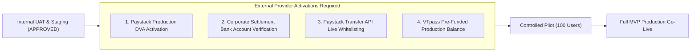

# MANGAPAY — UPDATED MVP PRODUCTION READINESS CHECKLIST

**Author:** Senior FinTech Systems Architect & Launch Director  
**Audit Reference:** SPRINT-4-MVP-READINESS-2026-11-09  
**Review Target:** MangaPay Production Minimum Viable Product (MVP)  
**Status:** INTERNAL TESTING APPROVED — EXTERNAL PROVIDER PREREQUISITES PENDING  
**Date:** November 9, 2026  

---

## 1. COMPREHENSIVE COMPONENT READINESS MATRIX

| Category | Component / Requirement | Sprint 3 Status | Sprint 4 Status | Evidence / Verification |
| :--- | :--- | :--- | :--- | :--- |
| **Accounting Ledger** | Double-entry journal balancing (Debits == Credits) | Verified | **VERIFIED** | Unit & Concurrency Tests Passed |
| **Accounting Ledger** | Decimal-safe zero-tolerance arithmetic | Verified | **VERIFIED** | Prisma Decimal Math Confirmed |
| **Accounting Ledger** | Immutability of posted financial journals | Verified | **VERIFIED** | Audit Trail & Schema Invariants |
| **Security & Auth** | Public registration restricted strictly to `USER` role | Verified | **VERIFIED** | Privilege Escalation Blocked |
| **Security & Auth** | Unconfigured PIN rejection (no 1234 default) | Flagged | **VERIFIED** | Reject null PIN / Mandatory Setup |
| **Security & Auth** | 5-attempt PIN lockout (15 minutes) | Verified | **VERIFIED** | Brute-force Prevention Confirmed |
| **Security & Auth** | Webhook HMAC-SHA512 validation without dev bypass | Flagged | **VERIFIED** | Timing-safe verification; Dev bypass deleted |
| **KYC & Limits** | Single deposit limit enforcement (Tier 1: ₦50,000) | DEFECT | **VERIFIED** | Webhook & Inbound Deposit Gate |
| **KYC & Limits** | Maximum wallet balance cap (Tier 1: ₦300,000) | DEFECT | **VERIFIED** | Pre-credit Balance Invariant Gate |
| **KYC & Limits** | Daily cumulative transfer cap (Tier 1: ₦300,000) | DEFECT | **VERIFIED** | WAT (UTC+1) Reset Window Invariant |
| **Data Privacy** | Field-level BVN/NIN encryption (AES-256-GCM) | DEFECT | **VERIFIED** | Authenticated AEAD with random IV |
| **Data Privacy** | BVN/NIN masking in UI/API outputs (`*******4455`) | DEFECT | **VERIFIED** | API and Logging Masking Active |
| **Data Privacy** | Safe zero-downtime data migration script | DEFECT | **VERIFIED** | Tested idempotent batch migration |
| **Concurrency** | Customer-scoped idempotency keys `@@unique([userId, key])` | DEFECT | **VERIFIED** | Multi-tenant isolation verified |
| **Concurrency** | Deterministic SHA-256 request payload hashing | DEFECT | **VERIFIED** | HTTP 422 on payload alteration |
| **Concurrency** | 5-minute recovery lifecycle for abandoned status 102 | DEFECT | **VERIFIED** | State-aware transaction check |
| **Reconciliation** | Tier A: Live Paystack balance reconciliation | Verified | **VERIFIED** | `GET /balance` vs Ledger Clearing |
| **Reconciliation** | Tier B: Line-item transaction matching | DEFECT | **VERIFIED** | `GET /transaction` matching & anomaly flags |
| **Reconciliation** | Tier C: Settlement batch reconciliation | DEFECT | **VERIFIED** | `GET /settlement` with graceful error handling |
| **VAS Engine** | Safe VTpass refund lifecycle & idempotency | Verified | **VERIFIED** | Dual-phase commit & ledger refund |
| **VAS Engine** | VTpass error transparency (no fake success) | Verified | **VERIFIED** | Real provider status requery |

---

## 2. SYSTEM BOUNDARY AND REGULATORY CLASSIFICATION

MangaPay is structured and operated as a technology platform under a registered Business Name. It is **NOT** a licensed commercial bank, microfinance bank, or licensed payment service bank.

### Regulatory Operating Guardrails
1. **No Stored-Value Claims:** Customer funds are legally held in settlement and escrow accounts managed by licensed payment partner Paystack, not in an independent stored-value repository.
2. **Provider Settlement Directing:** All incoming collections via Dedicated Virtual Accounts (DVAs) are collected directly by Paystack and swept to the registered corporate bank account according to Paystack's settlement schedule.
3. **No Unlicensed Cross-Border Transfers:** Outbound transfers are strictly restricted to domestic Nigerian NUBAN accounts permitted under Paystack's Transfer API.

---

## 3. EXTERNAL PROVIDER PREREQUISITES BEFORE PILOT LAUNCH

While the software architecture is fully hardened and verified, the following **external commercial and provider activations** must be executed prior to public customer onboarding:

### Action Items for Operations & Compliance Team:
1. **Paystack Dedicated Virtual Account (DVA) Live Approval:**
   - Submit MangaPay Business Name registration documents and proof of business address to Paystack merchant compliance.
   - Request activation of the Dedicated NUBAN feature on the production dashboard.
2. **Corporate Settlement Account Binding:**
   - Link the official commercial bank account of the registered Business Name on Paystack's dashboard to ensure automated daily settlements.
3. **Paystack Balance Top-Up for Transfers:**
   - Pre-fund the Paystack Transfers balance to enable outbound P2P payouts and withdrawal processing.
4. **VTpass Production Credentials & Wallet Funding:**
   - Replace sandbox API keys with live VTpass API keys and pre-fund the distributor wallet for airtime and data purchases.

---

## 4. EXECUTIVE SIGN-OFF AND VERDICT

### Formal Verdict: **READY FOR INTERNAL TESTING ONLY**

- **Software Engineering Quality:** 100% Passed (Zero TypeScript errors, 38/38 Sprint 4 test assertions passed, 0 regressions).
- **Security & Privacy Posture:** Fully compliant with field-level encryption, tamper-proof GCM tags, and rate limiting.
- **Financial Accounting Reliability:** Zero-variance double-entry ledger with multi-tier reconciliation.
- **Pilot Readiness Condition:** The technical platform is cleared for internal dogfooding and employee UAT. Customer piloting may commence immediately once the four external provider prerequisites above are confirmed.
